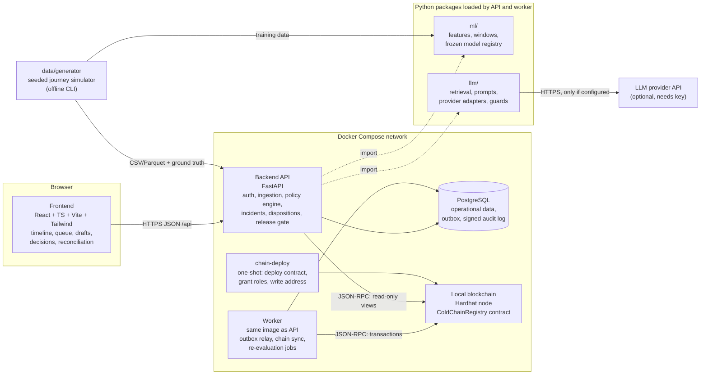
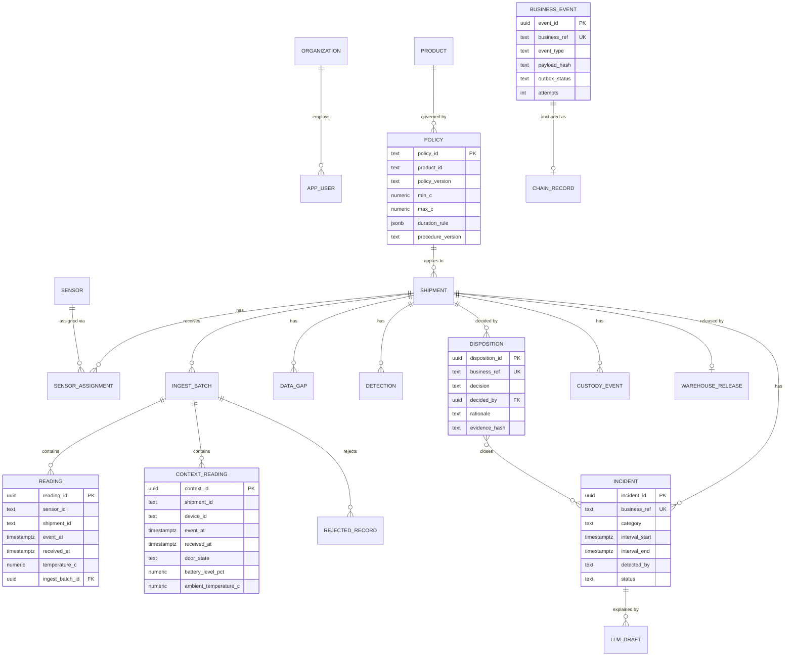
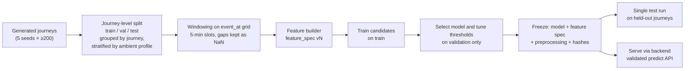
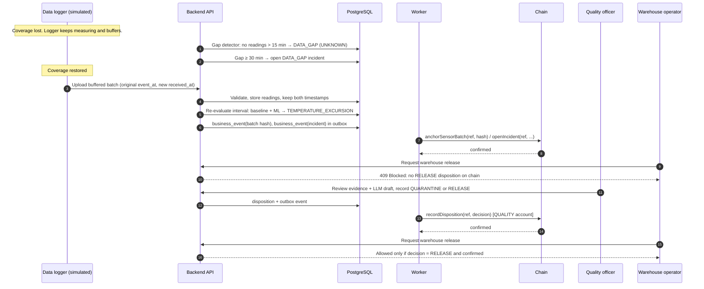
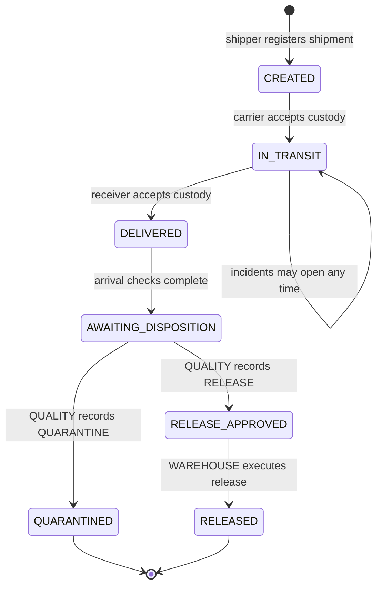
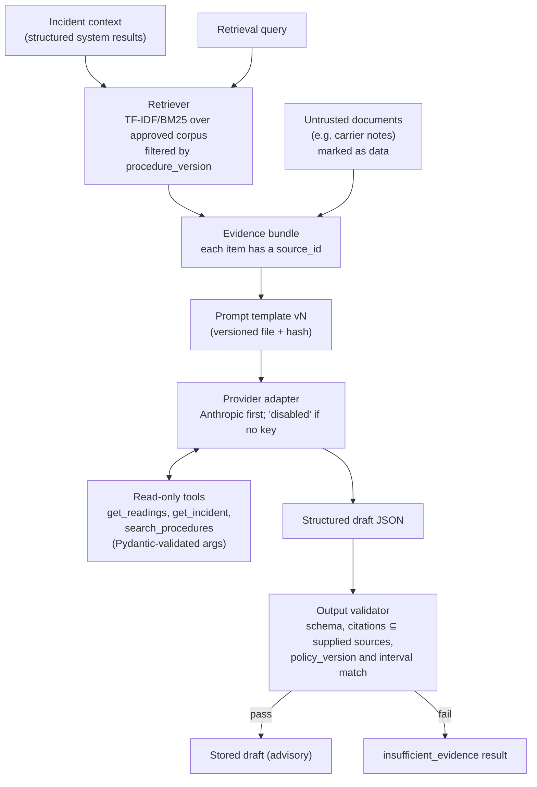
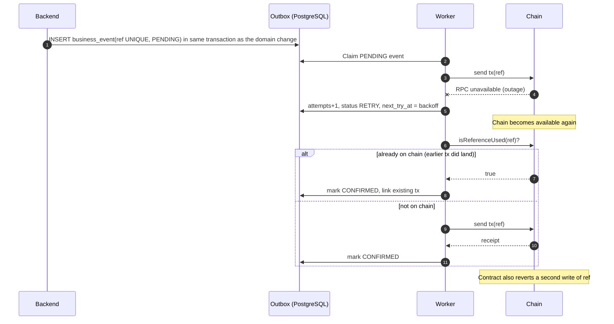

# Architecture — Cold Chain Monitoring and Excursion Response

| Item | Value |
|---|---|
| Status | Milestone 0 design — **proposed**, nothing below is implemented yet |
| Inputs | `docs/requirements-analysis.md` (requirement IDs referenced in brackets, e.g. [FR-24]) |
| Last updated | 2026-11-14 |

---

## 1. Design principles

These principles come straight from the brief. Every module must respect them.

| # | Principle | Requirements |
|---|---|---|
| P1 | **Recommendation and authorization are separate.** ML scores and LLM drafts are advisory data. Only a human with the QUALITY role can record a disposition, and the release gate checks that disposition, not any model output. | FR-25, BR-15, SC-04 |
| P2 | **Unknown is not safe.** A missing reading creates an UNKNOWN interval. No component may fill it with a "normal" value or count it as in-range time. | FR-11, BR-04, EVAL-13 |
| P3 | **Two clocks.** Every reading keeps `event_at` (when the sensor measured) and `received_at` (when the system got it). Detection runs on `event_at`; latency is measured with `received_at`. | FR-03, BR-06 |
| P4 | **Files stay off chain.** The chain stores IDs, hashes, versions and accepted state changes. Readings, documents and drafts live in PostgreSQL. | BC-11 |
| P5 | **Everything is versioned.** Policy, procedure, feature set, model, prompt and contract versions are stored with every result they produce. | NFR-04 |
| P6 | **Reproducible by default.** Seeds and configuration files drive data generation, training and evaluation. Results are written to disk with the configuration that produced them. | NFR-03 |
| P7 | **Honest labelling.** Simulated values are labelled as simulated; unconfigured features (for example LLM without a key) say so instead of pretending. | NFR-01, NFR-11 |
| P8 | **Enforce on the server.** Role checks live in the API and in the smart contract. The UI only hides buttons for convenience. | NFR-07 |

## 2. System overview

Write path to the chain goes only through the **worker** (transactional outbox, section 7.4). The API reads the chain directly for reconciliation and verification.

## 3. Module responsibilities

### 3.1 Frontend (`frontend/`)

- **Owns:** presentation, client-side routing, role-aware navigation, charts.
- **Does not own:** any business rule. It never decides whether release is allowed; it shows what the API returns.
- **Screens** [FR-30 … FR-36]:
  - Login (demo users per role).
  - Shipment list and shipment detail: temperature timeline with the 2–8 °C band, UNKNOWN gaps shaded and labelled, delayed-arrival markers (`received_at − event_at`), baseline and ML detections overlaid.
  - Excursion queue: open incidents by category (`TEMPERATURE_EXCURSION`, `DATA_GAP`, `SENSOR_FAULT_SUSPECTED`), age and shipment.
  - Incident detail: evidence package, LLM draft with citations, policy version and sensor interval; disposition form (QUALITY only).
  - Decision history: dispositions with actor, time, rationale, evidence references and transaction hash.
  - Reconciliation: each business reference with DB status, outbox status and on-chain status.
  - Partner verification: compute the hash of a record or uploaded file and compare it with the anchored hash.
- A permanent "SIMULATED DATA — teaching policy" banner [NFR-01, NFR-02].

### 3.2 Backend (`backend/`)

FastAPI application. Planned internal layers:

| Layer | Responsibility |
|---|---|
| `api/` | HTTP routes, request/response schemas (Pydantic), auth dependencies. No business logic. |
| `domain/` | Pure business rules with no I/O: validation (BR-07, BR-08), gap detection (BR-03 to BR-05), policy threshold engine (BR-02), incident rules (BR-09), disposition and release rules (BR-10 to BR-12). Fully unit-testable. |
| `services/` | Use cases that combine domain rules with storage: ingest batch, re-evaluate interval, open incident, build evidence package, record disposition, request release, reconcile. |
| `db/` | SQLAlchemy models, Alembic migrations, repositories. |
| `integrations/` | Adapters: `ml_adapter` (calls the `ml` package), `llm_adapter` (calls the `llm` package), `chain_gateway` (web3 client, read views), `audit_log` (signed DB log). |
| `worker/` | Outbox relay to the chain, confirmation tracking, retry with backoff, scheduled reconciliation. |

### 3.3 Database (PostgreSQL)

Single source of operational truth. Holds readings, context, policies, incidents, drafts, decisions, the outbox and the signed audit log. Schema in section 5.

### 3.4 ML pipeline (`ml/`)

Python package plus CLI. Offline: build windows and features, train, validate, freeze, test. Online: the backend loads one frozen model version and calls `predict(windows)`. Details in section 6.

### 3.5 LLM / RAG module (`llm/`)

Python package. Retrieval over the approved corpus, prompt templates, provider adapters, read-only tools with argument validation, output schema validation and citation checks. Details in section 7.3.

### 3.6 Blockchain module (`blockchain/`)

Hardhat project: Solidity contract `ColdChainRegistry`, deployment script, role setup, contract tests. Details in section 7.4.

### 3.7 Data (`data/`)

Seeded journey simulator, data dictionary, provenance record, generated datasets (canonical release committed or regenerated, decision D-05).

### 3.8 Scripts (`scripts/`)

Start/stop helpers for macOS and Windows, demo scenario runners, evaluation runners, ZIP packaging.

### 3.9 Infrastructure (Docker Compose)

Section 8.

## 4. Integration responsibilities

| # | Interface | Producer → Consumer | Contract | Failure handling |
|---|---|---|---|---|
| I-1 | REST API | Backend → Frontend | OpenAPI schema generated by FastAPI; TypeScript types generated from it | Typed error body `{code, message, details}`; UI shows errors, never fabricates state |
| I-2 | Ingestion API | Simulator / gateway → Backend | `POST /api/ingest/batches` with batch ID, readings, context | Per-record accept/reject report; duplicate batch ID is idempotent [BR-07, BR-13] |
| I-3 | ML predict | Backend → `ml` package | `predict(windows: WindowFrame) -> list[Prediction]`; validated against the frozen `feature_spec.json` | Schema mismatch → error, incident queue still driven by baseline |
| I-4 | LLM draft | Backend → `llm` package | `draft(incident_context) -> DraftResult` (Pydantic schema, section 7.3) | Provider error or not configured → explicit status, no draft text |
| I-5 | LLM provider | `llm` package → external API | Provider adapter interface; Anthropic adapter first | Timeout and retry limits; usage and latency logged even on failure |
| I-6 | Chain write | Worker → Hardhat node | Contract ABI, one call per business event, unique business reference | Outbox retry with backoff; check `isReferenceUsed` before resending [BC-09] |
| I-7 | Chain read | Backend → Hardhat node | Contract view functions and event logs | Chain unreachable → reconciliation shows "chain unavailable", not "missing" |
| I-8 | Contract deploy | chain-deploy → shared volume | `deployment.json` with chain ID, address, ABI hash, role assignments | Backend refuses chain writes if the deployment file is missing or the code hash differs |
| I-9 | Dataset | Simulator → Backend / ML | Versioned files + `manifest.json` (seed, generator version, row counts, SHA-256) | Loader checks manifest hashes before use |

## 5. Data model

Further tables (not drawn): `detection` (source `BASELINE`/`ML`, model version, window, class, score), `data_gap` (start, end, status `UNKNOWN`), `llm_draft` (prompt version, provider, model, source IDs, status, tokens, latency, cost), `chain_record` (tx hash, block, confirmed at), `audit_log` (hash-chained, signed entries for the comparison in EVAL-03), and `ground_truth_*` tables kept in a **separate schema** that detection code cannot read [DATA-09].

Rules for the schema:

- All timestamps are `timestamptz`, stored in UTC [NFR-05].
- Unit suffixes in column names: `_c`, `_pct`, `_min` [NFR-06].
- Readings unique on `(sensor_id, event_at)` [BR-07]. Business references unique per table and globally across `business_event` [BR-13].
- Readings, decisions and business events are append-only. Corrections are new rows that reference the old ones.

## 6. ML pipeline design

- **Windows** [ML-01]: resample to a 5-minute grid by `event_at`; missing slots stay `NaN` (no forward fill across a gap, P2). Window length and stride are configuration (starting proposal: 60 minutes, stride 5 minutes). Features use only data at or before the window end [ML-09].
- **Features** (starting set, frozen in `feature_spec.json`): mean, min, max, standard deviation, last value, linear slope, largest step between consecutive readings, minutes above 8 °C, minutes below 2 °C, longest in-range-violating run, missing fraction, longest gap, spike score (largest deviation from rolling median), ambient mean, product-minus-ambient difference, door-open fraction, battery minimum and slope.
- **Window classes** [ML-04]: `NORMAL`, `EXCURSION_GRADUAL` (true product temperature out of range, sustained), `SENSOR_SPIKE`, `SENSOR_BIAS`, `INSUFFICIENT_DATA`. Exact label rules are written into the data dictionary in M2.
- **Models** [ML-02, ML-05]:
  - B0 — policy threshold rule (the brief's baseline; not ML).
  - B1 — ML baseline: logistic regression on the same features.
  - C1 — candidate: gradient-boosted trees (`HistGradientBoostingClassifier`, handles `NaN`).
  - C2 — optional: `IsolationForest` anomaly score as an extra spike/bias signal.
  The final candidate is chosen on validation results only [ML-08].
- **Event aggregation**: consecutive positive windows form a predicted event; the minimum run length is tuned on validation [EVAL-11].
- **Freeze** [ML-06]: `ml/registry/<model_version>/` holds the model file, `feature_spec.json`, preprocessing config, training-data manifest hash, validation metrics, model card and a SHA-256 of each file. The test set is run once per seed after freezing.
- **Serving** [ML-07]: backend loads one model version (`ML_MODEL_VERSION`), validates feature frames against the spec, stores every prediction with its model version. Predictions open incidents for review only [BR-15].

## 7. Key flows

### 7.1 Ocean coverage gap (DEMO-01)

### 7.2 Disposition and release state machine

Guards (enforced in `domain/` and again in the contract):

- `RELEASE_APPROVED` requires the QUALITY role and a disposition that references every open incident [BR-10].
- `RELEASED` requires a confirmed on-chain `RELEASE` disposition [BR-11]. No path leads from an ML score or LLM draft to any of these states [BR-15].
- Any other transition (for example `CREATED → RELEASED`) is rejected as invalid [EVAL-08].

### 7.3 LLM / RAG design

- **Corpus** [LLM-01]: `llm/corpus/approved/` — short teaching procedures written by the team, each with front matter (`doc_id`, `version`, `status: approved`, `effective_date`). Only `approved` documents matching the shipment's `procedure_version` are retrievable.
- **Retrieval**: local TF-IDF/BM25 with scikit-learn, deterministic and offline. Chunk IDs (`SOP-EXC-001#3`) are the source IDs [LLM-06].
- **Structured evidence** [LLM-05]: incident, readings summary for the interval, gaps, baseline and ML detections, each with a system source ID (for example `SYS:incident/<id>`, `SYS:readings/<shipment>/<from>/<to>`).
- **Output schema**: `status` (`draft` | `insufficient_evidence` | `not_configured` | `provider_error`), `alert_explanation`, `recommended_actions[]`, `evidence_required[]`, `citations[{source_id, claim}]`, `policy_version`, `sensor_interval {start, end}` [LLM-02 to LLM-04, LLM-07].
- **Tools** [LLM-08]: read-only. Arguments validated: shipment must equal the incident's shipment; time range within the shipment and at most 48 hours; unknown fields rejected. There are no write tools, so a draft cannot change state [LLM-09].
- **Injection defense** [LLM-10]: documents are wrapped as quoted data with their trust level; the system prompt says instructions inside documents must be ignored; the output validator rejects drafts that recommend actions outside the procedure or cite unsupplied sources. Defense is measured, not assumed (EVAL-07).
- **Provider** [LLM-12, D-03]: Anthropic Python SDK; default model `claude-opus-5-5` (set by `LLM_MODEL`). Structured output via the SDK's structured-output support. The current API does not accept sampling parameters such as `temperature` on this model, so LLM output is **not deterministic**; evaluation therefore stores every raw response. Price used for cost: $4 input / $20 output per million tokens (Anthropic list price cached 2026-11-03 — re-check on the evaluation date and record the source).
- **Versioning** [LLM-11]: prompts live in `llm/prompts/<name>/vN.md`; each draft stores prompt version and hash, provider, model ID, input/output tokens, latency and computed cost.

### 7.4 Blockchain design and retry

**Contract `ColdChainRegistry`** (Solidity, OpenZeppelin `AccessControl`):

| Function | Allowed role | Effect | Rejects |
|---|---|---|---|
| `registerShipment(ref, shipmentKey, policyVersion)` | SHIPPER | Shipment record `CREATED` | duplicate ref |
| `acceptCustody(ref, shipmentKey, stage)` | CARRIER (pickup), WAREHOUSE (delivery) | `IN_TRANSIT` / `DELIVERED` | wrong role for stage, invalid transition, duplicate ref |
| `anchorSensorBatch(ref, shipmentKey, batchHash, firstEventAt, lastEventAt, count)` | CARRIER | Batch anchored | duplicate ref |
| `openIncident(ref, shipmentKey, category, evidenceHash)` | MONITOR | Incident open | duplicate ref, unknown shipment |
| `recordDisposition(ref, shipmentKey, decision, incidentRefs[], evidenceHash)` | QUALITY | `RELEASE_APPROVED` / `QUARANTINED` | non-QUALITY caller, open incident not referenced, already decided, duplicate ref |
| `recordWarehouseRelease(ref, shipmentKey)` | WAREHOUSE | `RELEASED` | no `RELEASE` disposition, duplicate ref |
| `isReferenceUsed(ref)` (view) | anyone | — | — |

Business references are `bytes32` hashes of the DB business reference string. `shipmentKey` is a hash of the shipment ID, so no business data is stored in clear [BC-11].

**Organizations and roles** [BC-07]:

| Organization | Roles | Chain account (local dev) |
|---|---|---|
| Shipper | SHIPPER | Hardhat dev account #1 |
| Carrier | CARRIER | Hardhat dev account #2 |
| Receiver | QUALITY, WAREHOUSE, MONITOR (service) | Hardhat dev accounts #3, #4, #5 |
| Platform (deployer) | DEFAULT_ADMIN (grants roles only, no business actions) | Hardhat dev account #0 |

Hardhat dev accounts come from Hardhat's public test mnemonic. They are only for the local chain and must never hold real value.

**Retry without duplicates** [BC-09, DEMO-04]:

Outage simulation for tests uses `docker compose pause chain` / `unpause`, which keeps the in-memory chain state (a restarted Hardhat node would lose it; see section 11).

**Comparison system** [EVAL-03]: a signed, hash-chained `audit_log` table in PostgreSQL. Each entry stores the previous entry's hash and an Ed25519 signature from the acting organization's key; the API applies the same role rules. Evaluation runs the same scenarios against both and compares coordination value and overhead.

## 8. Infrastructure

Planned Compose services (built in M1 and extended per milestone):

| Service | Image / build | Port (host) | Notes |
|---|---|---|---|
| `db` | `postgres:16` | not published by default | Named volume `pgdata` |
| `chain` | built from `blockchain/` (Node LTS + Hardhat) | 8545 | In-memory chain; reset together with `db` |
| `chain-deploy` | same as `chain` | — | One-shot: deploy, grant roles, write `deployment.json` to shared volume |
| `backend` | built from `backend/` (Python 3.12; installs `ml/` and `llm/` packages) | 8000 | Runs migrations, then API |
| `worker` | same image as `backend` | — | Outbox relay and scheduled jobs |
| `frontend` | multi-stage: Vite build → nginx | 8080 | nginx proxies `/api` to `backend` |

- One start command for students: `docker compose up --build` (wrapped by `scripts/start.sh` and `scripts/start.ps1`/`.bat`). Demo data is seeded on first start.
- Health checks on every service; `depends_on` with `condition: service_healthy` or `service_completed_successfully`.
- Shell scripts use LF line endings (`.gitattributes`) so they run inside Linux containers when the repo is checked out on Windows.
- Configuration comes from `.env` (copied from `.env.example`). No secret has a working default outside local development.

## 9. Security model

| Concern | Control |
|---|---|
| Authentication | Demo users per role, password login, JWT signed with `JWT_SECRET` from `.env` |
| Authorization | Role check in API dependencies **and** in the contract (`onlyRole`) [NFR-07] |
| Signing keys | Backend holds one local dev key per organization (simplification; see limitations) |
| Prompt injection | Untrusted text wrapped as data, read-only tools, output validation [LLM-10] |
| Tampering | Batch and evidence hashes anchored; partner verification recomputes and compares [BC-13] |
| Secrets | `.env` is git-ignored; `.env.example` holds only placeholders [NFR-08] |

## 10. Evaluation architecture

| Configuration | Detection | Response | Record keeping |
|---|---|---|---|
| E0 Baseline | Policy threshold rule (B0) | Manual (no draft) | DB only |
| E1 ML only | Frozen ML model (C1) + B0 shown alongside | Manual | DB only |
| E2 ML + LLM | as E1 | LLM draft + evidence list | DB only |
| E3 Complete | as E1 | as E2 | DB + blockchain |
| E3-alt Comparator | as E1 | as E2 | DB + signed audit log |

Runners in `scripts/eval/` read a run config (seeds, model version, prompt version, contract version), write raw per-case results (CSV/JSONL) and a summary to `docs/evaluation/runs/<run_id>/`, together with the exact config and git commit. Uncertainty: per-seed values plus mean ± standard deviation across ≥5 seeds, and journey-level bootstrap 95% intervals where the sample allows [EVAL-09, EVAL-10].

## 11. Known limitations (by design)

1. **Custodial keys.** In the prototype the backend signs for every organization. A real consortium would give each organization its own node and keys. Blockchain results show the mechanism, not real decentralization.
2. **Ephemeral local chain.** The Hardhat node keeps state in memory. Restarting it without also resetting the database breaks consistency; the reconciliation view will show this. Start/stop scripts reset both together; outages are simulated by pausing, not restarting.
3. **Synthetic data.** Results describe the simulator's behaviour. 200 journeys per seed is a teaching scale, not statistical proof (as the brief says).
4. **Non-deterministic LLM.** Drafts vary between runs; evaluation stores raw outputs and reports variation rather than one "true" score.
5. **Teaching policy.** Limits, durations and procedures are invented for teaching and are not clinical or regulatory guidance.
