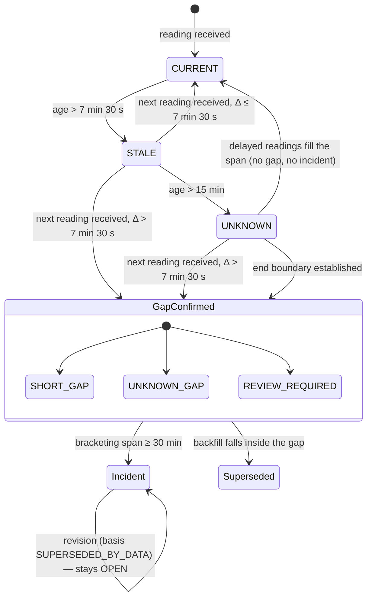

# M3 baseline detector contract

| Item | Value |
|---|---|
| Status | **Approved and implemented in Milestone 3 (2026-11-15).** BR-05, C-01 to C-10, the BR-06 to BR-09 decisions and U-01 to U-08 are approved (§2, §9). Implementation: `backend/app/domain/`, `backend/app/services/`, migration `0003`; report: `docs/milestones/m3/README.md`. M3 awaits the owner's acceptance |
| Serves | FR-01, FR-03, FR-04, FR-10, FR-11, FR-12, FR-20, EVAL-01, EVAL-04, EVAL-05, EVAL-13, DATA-09, BR-02 to BR-09, D-01, D-09, D-12, A-02 |
| Inputs | `docs/requirements-analysis.md` §13–§15, `docs/architecture.md` §3.2, §5, §7.1, §10, `docs/implementation-plan.md` M3, `data/dictionary/data-dictionary.md` §2.5, §4, §5 |
| Does not change | Policy `POL-CHILL-01` v1.0 (file and version), the canonical dataset `coldchain-sim-v1.0.0-seed11`, the ground-truth labels, any code |
| Last updated | 2026-11-15 |

The detector is the M3 *policy baseline* (B0 in architecture §10). It turns observed readings into monitoring states, confirmed gaps, temperature runs, data-quality warnings and incidents. ML detection (M4) is out of scope.

---

## 1. Principles and notation

1. **Observed data only.** Operational detection reads accepted rows of `reading`, the shipment's policy, its detector configuration and its sensor assignment. It never reads schema `ground_truth` or the `ground_truth/` files [DATA-09, D-12]. The detector modules live in `backend/app/domain/` and `backend/app/services/`, which `backend/tests/test_ground_truth_boundary.py` already scans. Ground truth is used only by the isolated M9 evaluation code (§6).
2. **No invented measurements.** The detector never interpolates, forward-fills, snaps a timestamp to a grid, rounds a value or creates a reading. Missing time is never assumed to be in range (C-06).
3. **Deterministic** (C-07). The result for one sensor on one shipment is a pure function of: the readings known at the processing time, the policy version, the detector configuration version, the documented monitoring boundaries known at that time, and the processing time itself. Durations are compared as exact time intervals (microseconds), never as floating-point minutes. Row identifiers are UUIDv5 values derived from stable keys, as in the M2 importer.
4. **Causal** (C-09). An evaluation at processing time `as_of` uses only readings with `received_at ≤ as_of` and only monitoring boundaries that have been reached by `as_of`.
5. **Event time decides, processing time is recorded.** Order, runs, gaps and durations use `event_at`. `received_at` and `as_of` are stored for delay measurement and never reorder readings [BR-06].
6. **History is kept** (C-08). Every change is a new revision. Nothing is deleted or overwritten. Only a quality disposition closes an incident [BR-09].
7. **Operational names differ from ground-truth names** (A-12). The detector uses category `TEMPERATURE_EXCURSION` with `direction` = `HIGH`/`LOW`. It never emits `EXCURSION_HIGH`, `EXCURSION_LOW`, `in_policy_excursion` or other tokens that the OpenAPI guard rejects.

| Symbol | Meaning | Value | Source |
|---|---|---|---|
| *I* | Nominal sampling interval | 5 min | D-01, detector configuration |
| *M* | Maximum interval between consecutive readings that still counts as continuous | 7 min 30 s | **C-01** |
| Δ | `event_at` of a reading minus `event_at` of the previous accepted reading of the same sensor | exact | measured |
| *H*, *L* | High / low excursion duration | 30 min, 15 min | policy v1.0 |
| *U*, *R* | Gap UNKNOWN threshold / review threshold | > 15 min, ≥ 30 min | policy v1.0 |

---

## 2. Final decision table

| ID | Decision | Status | Where specified |
|---|---|---|---|
| BR-05 | Gaps break observed runs; out-of-range readings adjacent to a confirmed gap are flagged; no exposure inferred across missing readings; short gaps included; a run below its threshold is never confirmed on unobserved time; runs on both sides of a gap are separate; duration = last − first `event_at` (7 readings = 30 min, 4 = 15 min); a qualifying adjacent run carries the gap-continuity warning; otherwise a data-quality warning | Approved 2026-11-15 | §3 |
| C-01 | Two consecutive readings are continuous when Δ ≤ 7 min 30 s. Original timestamps are kept | Approved 2026-11-15 | §5.6, §5.8 |
| C-02 | Option B: a `DATA_GAP` incident opens only for a **confirmed** missing-data interval ≥ 30 min. Missing or stale telemetry is visible before that as monitoring state STALE or UNKNOWN, never as safe. Monitoring states, confirmed gaps and incidents are distinct | Approved 2026-11-15 | §5.7 |
| C-03 | Ordinary data-quality warnings need no separate approval. Warnings that affect product-quality evidence go into the Quality Officer's evidence package | Approved 2026-11-15 | §5.11 |
| C-04 | No grace period. Documented monitoring boundaries (sensor assignment start and end) are used where available. An unestablished boundary is represented as UNKNOWN, not as an invented time limit | Approved 2026-11-15 | §5.5 |
| C-05 | Policy thresholds are compared exactly, with no extra temperature or duration tolerance | Approved 2026-11-15 | §5.6, §5.8 |
| C-06 | Missing intervals are never assumed to be in range | Approved 2026-11-15 | §5.7, §5.9 |
| C-07 | The full sensor journey is recalculated whenever delayed readings or backfill change the observed sequence. Computation is deterministic | Approved 2026-11-15 | §5.10 |
| C-08 | Historical incident versions are kept. Earlier incident decisions are never silently overwritten or erased | Approved 2026-11-15 | §5.12 |
| C-09 | Live mode uses trusted server receipt time. Replay uses the recorded `received_at` timeline and is causal: a reading is never used before its recorded receipt time | Approved 2026-11-15 | §5.4 |
| C-10 | Reprocessing history under another policy or detector configuration is an explicitly versioned offline operation | Approved 2026-11-15 | §5.13 |
| BR-06 | Preserve both timestamps; live or replay clock; reprocessing keeps incident history | Approved 2026-11-15; consistent with the wording, U-02 asks the owner to confirm one reading | §4.1 |
| BR-07 | Identical duplicates have no duplicate business effect; conflicts rejected and logged; first accepted reading never overwritten; one conflict never opens `SENSOR_FAULT_SUSPECTED` | Approved 2026-11-15; consistent, with one extension (context records, U-05) | §4.2 |
| BR-08 | Precision validated without rounding; documented min and max accepted; ≤ 5 min future skew; delayed data not rejected for lateness; server sets `received_at` live; trusted imported timestamps in replay | Approved 2026-11-15; consistent, precision check recorded as an amendment | §4.3 |
| BR-09 | M3 opens `TEMPERATURE_EXCURSION` and confirmed `DATA_GAP` incidents; sensor-fault suspicion stays a persisted warning; incidents never deleted; supersession distinct from quality closure | Approved 2026-11-15, **amended explicitly by U-01** (original wording kept) | §4.4 |
| A-02 | Detection delay separated into physical onset (ground truth), first observed evidence and earliest emission time | Structure set by the owner 2026-11-15; formal definitions in §6 | §6 |
| U-01 | BR-09 amendment: M3 creates `TEMPERATURE_EXCURSION` and `DATA_GAP` incidents; sensor-fault suspicion is a persisted, auditable data-quality warning, in quality evidence when relevant; `SENSOR_FAULT_SUSPECTED` reserved for the future | Approved 2026-11-15 | §4.4, §5.11 |
| U-02 | `raised_at` is the clock for causal detection-delay metrics; `created_at` is the real database time | Approved 2026-11-15 | §5.4, §6 |
| U-03 | Readings without a valid sensor assignment or outside the documented monitoring window never enter detection; rejected with reason and raw payload | Approved 2026-11-15 | §4.3 |
| U-04 | Late data never mutates or erases a quality disposition; evidence revisions are appended and affected decisions flagged for human reassessment; executed releases stay visible | Approved 2026-11-15 | §5.12 |
| U-05 | Idempotency and conflict checks for context records linked to readings | Approved 2026-11-15 | §4.2, §5.11 |
| U-06 | Deterministic one-to-one event matching for offline evaluation, with defined and tested tie-breaks | Approved 2026-11-15 | §6.3 |
| U-07 | No chain anchoring of incident revisions in M3; revisions and business references kept for M5 | Approved 2026-11-15 | §5.12 |
| U-08 | BR-10 to BR-15 reviewed for M3: no conflict (requirements analysis §13.5) | Reviewed 2026-11-15 | §9 |

---

## 3. BR-05 (approved)

The owner's ten points are recorded in requirements analysis §13.1. They answer the six questions of §13.3:

| # | Question | Rule |
|---|---|---|
| 1 | "Directly before or after" | The run's **last** reading opens the confirmed gap, or its **first** reading closes it. A run that ended one in-range reading before the gap is not adjacent (B25) |
| 2 | Which gaps | Every confirmed gap (Δ > *M*), including short gaps and boundary gaps (§5.5) |
| 3 | Run shorter than the threshold | No `TEMPERATURE_EXCURSION` incident; a `GAP_ADJACENT_OUT_OF_RANGE` warning (§5.11) |
| 4 | Runs on both sides of a gap | Two runs, each evaluated and flagged on its own |
| 5 | Duration | `last.event_at − first.event_at`; one reading gives 0 min. Also used for BR-02 operational detection |
| 6 | Where the flag lives | On the excursion incident if the run qualifies; otherwise on the warning, linked to the `DATA_GAP` incident when one exists |

---

## 4. BR-06 to BR-09: exact wording and comparison with the approved decisions

Comparison results:

- **Consistent:** the decision follows from the wording.
- **Extension:** the decision adds something the wording does not say, without contradicting it. It is recorded as an approved amendment, and the original wording is kept.
- **Conflict:** the decision and the wording disagree. These are left unresolved.

### 4.1 BR-06

> "Readings are evaluated in `event_at` order. `received_at` is kept unchanged. Late readings trigger re-evaluation of the affected interval. Each alert stores both the event interval and the wall-clock time it was raised."

| Approved decision | Wording it relates to | Result |
|---|---|---|
| Preserve `event_at` and `received_at` | "`received_at` is kept unchanged"; `event_at` is preserved by FR-03 | Consistent |
| Live or replay clock (C-09) | "the wall-clock time it was raised" | **Consistent with a condition.** In replay the processing clock is the recorded `received_at` timeline, not the real clock. Every alert therefore stores both `raised_at` (processing clock, used for metrics) and `created_at` (the real database wall-clock time). The literal wording is met. U-02 asks the owner to confirm that `raised_at` is the time metrics use |
| Full-journey recalculation (C-07) | "re-evaluation of the affected interval" | Consistent: the full journey contains the affected interval. The affected range is still recorded (`affected_from_at`, `affected_to_at`) |
| Reprocessing keeps incident history (C-08, C-10) | Not mentioned | Extension |
| Events processed in `event_at` order | "evaluated in `event_at` order" | Consistent |

**Rule for implementation.** Readings are ordered by `event_at`. Both timestamps are stored and returned unchanged. A batch whose readings change the observed sequence triggers a full recalculation of that sensor's journey. Every output stores its event interval, `raised_at` and `created_at`. Earlier outputs are superseded, never deleted.

### 4.2 BR-07

> "Duplicate readings (same `sensor_id` and `event_at`): an identical value is ignored as a duplicate; a different value is rejected as a conflict and kept for review. Existing readings are never overwritten."

| Approved decision | Wording | Result |
|---|---|---|
| Identical duplicates have no duplicate business effects | "an identical value is ignored as a duplicate" | Consistent. The duplicate is counted in the batch result (`duplicate_count`, record indices) so it is not silently dropped (FR-01). It is not a `rejected_record`, because the rule says *ignored*, not *rejected* |
| Conflicts rejected and logged for review | "a different value is rejected as a conflict and kept for review" | Consistent: `rejected_record` with `DUPLICATE_CONFLICT`, plus a `READING_CONFLICT` warning in the evidence package |
| First accepted reading not overwritten | "Existing readings are never overwritten" | Consistent |
| One conflict does not open `SENSOR_FAULT_SUSPECTED` | Not mentioned | Consistent (the wording is silent) |
| The same rules for context records | The wording names *readings* only | **Extension**, approved (U-05). A context record must also belong to a reading of the same shipment (`CONTEXT_WITHOUT_READING`) |

**Rule for implementation.** Key `(sensor_id, event_at)`, with `event_at` compared as an exact instant. *Identical* means the same `shipment_id` and the same `temperature_c` compared as decimals (8.0 = 8.00). `received_at` and batch may differ. A different `shipment_id` with the same key is a conflict. Within a batch, records are taken in order. A record rejected by BR-08 is never "the first accepted reading".

### 4.3 BR-08

> "Validation: `temperature_c` must be within −40 °C to +60 °C (sensor physical range); `event_at` may not be more than 5 minutes after `received_at` (clock skew tolerance). Failing records are rejected with a reason."

| Approved decision | Wording | Result |
|---|---|---|
| Validate precision without silent rounding | Not mentioned | **Extension** (a new rejection reason). The limit is what the column stores exactly: `reading.temperature_c NUMERIC(6,2)`, so at most 2 decimal places. More digits are rejected as `PRECISION_EXCEEDED`, never rounded |
| Documented minimum and maximum accepted | "within −40 °C to +60 °C" | Consistent: the range is inclusive |
| Up to 5 min of future skew permitted | "may not be more than 5 minutes after `received_at`" | Consistent: exactly 5 min 0 s accepted, anything more rejected (`CLOCK_SKEW`) |
| Delayed data not rejected because `received_at` is much later | The rule limits only `event_at` after `received_at` | Consistent |
| Live: server controls `received_at` | Not mentioned | Extension (with C-09). The live request schema has no `received_at` field; a request that sends one is refused with 422 |
| Replay: trusted imported timestamps | Not mentioned | Extension (with C-09). Only the internal replay or import path may supply `received_at` (`source = SIMULATOR`, `data_origin = SIMULATED`); it is not exposed over HTTP in M3 |

Schema checks required by FR-01 (not BR-08) reject missing fields, NaN or infinity, non-numeric values, timestamps without a time zone, unknown sensors and unknown shipments, each with its own reason code. Readings outside the sensor's documented monitoring window (`OUTSIDE_MONITORING_WINDOW`), or from a sensor with no assignment to the shipment (`SENSOR_NOT_ASSIGNED`), are rejected with a reason and their raw payload, and never reach detection (U-03).

### 4.4 BR-09

> "Incident categories: `TEMPERATURE_EXCURSION`, `DATA_GAP`, `SENSOR_FAULT_SUSPECTED`. No incident is closed automatically, including suspected sensor faults; only a quality disposition closes it."

| Approved decision | Wording | Result |
|---|---|---|
| M3 implements excursion and confirmed data-gap incidents | The three allowed categories | Consistent (a subset) |
| Sensor-fault suspicion can remain a data-quality warning | "No incident is closed automatically, **including suspected sensor faults**" | Was a conflict; **resolved by the explicit amendment U-01** (2026-11-15). The original wording is kept in the requirements analysis with the amendment beside it. In M3 the only fault-suspicion signal is the BR-07 `READING_CONFLICT` warning: persisted, never deleted, always in the evidence package. `SENSOR_FAULT_SUSPECTED` stays reserved |
| Incidents not silently deleted when later readings change the evidence | "No incident is closed automatically" | Consistent |
| Supersession distinguishable from quality closure | "only a quality disposition closes it" | Consistent: `status` (`OPEN`/`CLOSED`, changed only by a disposition) and `basis` (`CURRENT`/`SUPERSEDED_BY_DATA`/`MERGED_INTO`, changed only by the detector) are separate fields |

---

## 5. Detector contract

### 5.1 Input records

| Input | Source | Used for |
|---|---|---|
| Accepted readings | `reading` (`sensor_id`, `shipment_id`, `event_at`, `received_at`, `temperature_c`, `ingest_batch_id`), filtered to `received_at ≤ as_of` | Runs, gaps, delays |
| Batch | `ingest_batch` (`received_at`, `business_ref`, `source`, `data_origin`) | Trigger; replay timeline |
| Monitoring boundaries | `sensor_assignment.assigned_from` (required), `assigned_to` (nullable) | Boundary gaps; monitoring state (§5.5) |
| Policy | `policy` row referenced by `shipment.policy_id` | Limits, durations, gap thresholds |
| Detector configuration | `detector_config` row (§5.3) | *I*, *M* |
| Processing time `as_of` | Server UTC (live) or replay timeline (§5.4) | Causality, `raised_at`, monitoring state |

Context readings are not used by the baseline. Rejected records and ignored duplicates are not readings. Nothing from schema `ground_truth` is an input.

### 5.2 Policy version resolution

1. The policy is the one linked to the shipment (`shipment.policy_id`), fixed when the shipment was created. A policy published later never changes an existing shipment.
2. Values come from the database row seeded from the immutable policy file, which carries `content_sha256`. No limit appears in detector code.
3. A shipment without a resolvable policy is not evaluated. The evaluation records an explicit error, and no default policy is used.
4. Every evaluation and incident stores `policy_id`. Reports show `policy_code`, `policy_version` and `content_sha256`.
5. A `RETIRED` policy still governs the shipments linked to it.

### 5.3 Detector configuration (nominal interval)

The interval lives in a versioned detector configuration, not in the policy (requirements analysis §13.1). The file `backend/app/seed/data/detector/DET-BASELINE_v1.0.0.json` is seeded and hashed like the policy into a new table `detector_config`:

```json
{
  "detector_code": "DET-BASELINE",
  "config_version": "1.0.0",
  "nominal_sampling_interval_s": 300,
  "max_continuous_interval_s": 450,
  "approval_reference": "Nominal interval approved 2026-11-15 (D-01); 7 min 30 s continuity approved 2026-11-15 (C-01)"
}
```

Versions are immutable. Load-time checks: `nominal_sampling_interval_s < max_continuous_interval_s < 2 × nominal_sampling_interval_s`, so one missing reading is always a gap. There is no grace period (C-04). Every evaluation stores `detector_config_id` (code, version, `content_sha256`) next to `policy_id`.

### 5.4 Clocks, live mode and replay causality (C-09)

| Clock | Field | Used for | Never used for |
|---|---|---|---|
| Event time | `event_at` | Order, Δ, runs, gaps, durations, incident intervals | — |
| Receipt time | `received_at` (stored unchanged) | Causality filter, delay metrics | Ordering readings, gap or run decisions |
| Processing time | `as_of` → stored as `raised_at` | When an output was first produced; monitoring state; boundary reached | Durations or gaps |
| Database time | `created_at` | Audit; the literal BR-06 "wall-clock time" | Metrics |

**Live mode.** The ingestion service sets `received_at` to the trusted server UTC time when it receives the batch. Each committed batch triggers an evaluation with `as_of` = server UTC at evaluation. Recording a monitoring end boundary triggers an evaluation too. M3 records an end boundary only as a fact that has already happened, never as a planned future time, so no scheduler is needed. Monitoring state (§5.7) is computed on request with `as_of` = now.

**Replay mode.** The timeline consists of the dataset's batches at their recorded `received_at` values, plus each documented boundary at its own time (`assigned_from`, `assigned_to`). Steps are ordered by time. Ties are broken in this order: start boundary, then batches by `business_ref`, then end boundary. At each step `as_of` is the step time, and:

1. Only readings with `received_at ≤ as_of` are visible, even if later readings are already stored (for example after the M2 bulk import).
2. A boundary is used only when `as_of` ≥ that boundary time, even if `assigned_to` is already stored.
3. `raised_at` is the step time, so results do not depend on when or how fast the replay runs.

Replay goes through the same ingestion and detection services in-process (`source = SIMULATOR`). An equivalent *in-database causal replay* over already-imported readings may be used for M9. It must give identical outputs (B68).

### 5.5 Monitoring boundaries (C-04)

| Boundary | Documented source | When it counts as established |
|---|---|---|
| Start | `sensor_assignment.assigned_from` (NOT NULL in the schema) | `as_of ≥ assigned_from` |
| End | `sensor_assignment.assigned_to` | Value present **and** `as_of ≥ assigned_to` |

- **Leading interval** (start boundary → first reading). If longer than *M*, it is a confirmed gap with `start_bound = MONITORING_START`.
- **Trailing interval** (last reading → end boundary). Once the end boundary is established, an interval longer than *M* is a confirmed gap with `end_bound = MONITORING_END`. Later data can still supersede it (§5.10).
- **End boundary not established** (`assigned_to` is NULL, or not yet reached). The interval after the newest reading is never confirmed and never opens an incident. It stays visible as monitoring state STALE or UNKNOWN (§5.7) for as long as that is true. No time limit is invented. If a disposition is prepared while the end is still not established, the open-ended UNKNOWN interval appears in the evidence package.
- **No readings.** With both boundaries established, the whole window is one confirmed gap. Without an end boundary, the monitoring state is UNKNOWN from `assigned_from`.

BR-03 defines gaps between two readings. Boundary gaps extend that definition under C-04.

### 5.6 Gap detection: bracketing span versus estimated missing samples

For consecutive bounds *a* (an accepted reading, or the start boundary) and *b* (the next accepted reading, or the established end boundary):

- **Bracketing span** `= b − a`, computed on the original timestamps as an exact interval (stored as `bracketing_span_s`, microsecond precision). It is the only gap measurement compared with policy thresholds.
- A **missing-reading gap** exists when bracketing span `> M` (7 min 30 s). Otherwise the two are continuous (C-01).
- **Status** (policy v1.0, compared exactly, C-05):
  - bracketing span `≤ 15 min` → `SHORT_GAP`;
  - `15 min <` bracketing span `< 30 min` → `UNKNOWN`;
  - bracketing span `≥ 30 min` → `UNKNOWN_REVIEW_REQUIRED`, which opens a `DATA_GAP` incident (C-02).
- **Estimated missing samples** = ⌈(bracketing span − *I*/2) / *I*⌉ − 1 (`estimated_missing_samples`), and the **estimated missing duration** they represent = estimated missing samples × *I* (`estimated_missing_duration_s`). These are a *different measurement*: one missing reading on the 5-minute grid gives a bracketing span of 10 min but an estimated missing duration of 5 min. They are information only, never compared with a policy threshold and never create readings. The same names are used in the database, the API, the dashboard and reports.
- The bracketing span is the full distance between the bounding readings. It is **not** the bracketing span minus *I*. This matches the policy text ("a gap between readings") and the reference label `MISSING_DATA` ("from the last delivered reading before the missing run to the next delivered reading").

Boundary examples (nominal 5-minute grid and jittered timestamps):

| Opening bound | Closing bound | Bracketing span | Result | Est. missing samples | `DATA_GAP` incident |
|---|---|---|---|---|---|
| 10:00:00 | 10:05:00 | 5:00 | continuous | 0 | no |
| 10:00:00 | 10:07:30.000 | 7:30.000 | continuous (= *M*) | 0 | no |
| 10:00:00 | 10:07:30.001 | 7:30.001 | `SHORT_GAP` | 1 | no |
| 10:00:00 | 10:10:00 | 10:00 | `SHORT_GAP` | 1 | no |
| 10:00:03 | 10:15:02 | 14:59 | `SHORT_GAP` | 2 | no |
| 10:00:00 | 10:15:00.000 | 15:00.000 | `SHORT_GAP` (not > 15) | 2 | no |
| 10:00:00 | 10:15:00.001 | 15:00.001 | `UNKNOWN` | 2 | no |
| 10:00:00 | 10:20:00 | 20:00 | `UNKNOWN` | 3 | no |
| 10:00:02 | 10:29:58 | 29:56 | `UNKNOWN` | 5 | **no** (exact comparison) |
| 10:00:00 | 10:29:59.999 | 29:59.999 | `UNKNOWN` | 5 | no |
| 10:00:00 | 10:30:00.000 | 30:00.000 | `UNKNOWN_REVIEW_REQUIRED` | 5 | **yes** |
| 09:59:58 | 10:30:01 | 30:03 | `UNKNOWN_REVIEW_REQUIRED` | 5 | yes |
| 10:00:00 | 10:40:00 | 40:00 | `UNKNOWN_REVIEW_REQUIRED` | 7 | yes |

### 5.7 Monitoring states, confirmed gaps and data-gap incidents (C-02)

Three separate layers:

| Layer | Clock | Stored? | Can change? | Opens an incident? | Meaning |
|---|---|---|---|---|---|
| **Monitoring state** (`CURRENT`, `STALE`, `UNKNOWN`, `NOT_STARTED`, `ENDED`) | processing time | No; computed for `as_of` | At every evaluation or request | Never | How fresh the telemetry is now. The span after the newest reading is "not yet received", never in range |
| **Confirmed gap** (`SHORT_GAP`, `UNKNOWN`, `UNKNOWN_REVIEW_REQUIRED`) | event time | Yes, as revisions | Superseded by backfill only | Only at ≥ 30 min | A missing-data interval bounded by received readings or established boundaries |
| **`DATA_GAP` incident** | — | Yes; persistent | Revisions only; status closed only by a quality disposition | — | A confirmed gap ≥ 30 min that needs quality disposition (BR-04) |

**Monitoring state** for one sensor at `as_of`, with `newest` = the latest `event_at` among readings with `received_at ≤ as_of`:

| Condition | State | Displayed |
|---|---|---|
| `as_of < assigned_from` | `NOT_STARTED` | — |
| End boundary established | `ENDED` | Coverage from confirmed gaps |
| No reading yet: age = `as_of − assigned_from`; otherwise age = `as_of − newest` | | |
| age ≤ 7:30 | `CURRENT` | Newest value; span after `newest` "not yet received" |
| 7:30 < age ≤ 15:00 | `STALE` | "No data since `newest`" plus its age |
| age > 15:00 | `UNKNOWN` | "UNKNOWN since `newest`" plus its age; `provisional_review_threshold_reached` once age ≥ 30:00 (no incident) |

A reading ahead of the server clock (allowed skew) gives a negative age, which is `CURRENT`.

The dataset's gateways upload every 15 minutes (data dictionary §4.3). Between uploads the newest received reading is routinely older than 7 min 30 s, and just before an on-schedule upload it is usually a little older than 15 min, so the display passes through `STALE` and briefly `UNKNOWN` before almost every upload. Measured on the ocean demo shipment: 161 of 164 batches arrived while the state was `UNKNOWN` (`docs/milestones/m3/raw/06-api-via-proxy.txt`). This is honest (the system does not have that data) and creates no incident, but it means `UNKNOWN` alone does not indicate a delivery problem. The deliveries API therefore reports the factual `unobserved_before_receipt_s` and a `late_backfill` flag that reuses the approved 30-min review value (no new threshold). Whether the monitoring display needs an upload-cadence-aware threshold is an open question for the owner (§9).



### 5.8 Temperature runs

For one sensor, with the visible readings sorted by `event_at`:

1. **Classify.** `HIGH` if `temperature_c > max_temp_c`, `LOW` if `< min_temp_c`, otherwise `IN_RANGE`. 8.0 and 2.0 are in range. No tolerance (C-05).
2. **Runs.** A run is a maximal sequence of consecutive readings with the same non-`IN_RANGE` class and Δ ≤ *M* between each neighbour pair. A run ends at an in-range reading, a change of direction, or a confirmed gap.
3. **Measure.**
   - `observed_duration = last.event_at − first.event_at`, an exact interval.
   - `meets_policy_duration = observed_duration ≥ H` (HIGH) or `≥ L` (LOW).
   - `confirmed_event_at` = `event_at` of the first reading whose distance from `first.event_at` reaches the threshold.
   - `peak_c` = the maximum for HIGH, the minimum for LOW.
4. **Adjacency** (BR-05). `preceded_by_gap` = a confirmed gap closed by the run's first reading. `followed_by_gap` = a confirmed gap opened by the run's last reading. `run_open` = the run's last reading is the newest visible reading and no confirmed gap follows it.
5. **Outputs.**

| Run | Adjacent to a confirmed gap | Output |
|---|---|---|
| Meets threshold | no | `TEMPERATURE_EXCURSION` incident (direction), `gap_continuity_warning = false` |
| Meets threshold | yes | `TEMPERATURE_EXCURSION` incident, `gap_continuity_warning = true` ("excursion may have continued during gap") |
| Below threshold | yes | `GAP_ADJACENT_OUT_OF_RANGE` warning, linked to the `DATA_GAP` incident if one exists |
| Below threshold | no | Near-miss detection only |

An open run that already meets its threshold opens the incident immediately. Later readings extend it through revisions.

Duration examples with jitter (HIGH, *H* = 30 min):

| Readings (all > 8.0) | Δ between neighbours | `observed_duration` | Excursion |
|---|---|---|---|
| 7 readings, 10:00:00 … 10:30:00 | 5:00 | 30:00 | yes, confirmed at 10:30:00 |
| 7 readings, 10:00:01 … 10:30:00 | ≈ 5:00 | 29:59 | no; an 8th at 10:35:00 confirms it |
| 7 readings, 10:00:02 … 10:30:02 | 5:00 | 30:00 | yes |
| 5 readings, 10:00:00, 10:07:30, 10:15:00, 10:22:30, 10:30:00 | 7:30 | 30:00 | yes, with only 5 readings |
| 10:00:00, 10:05:00, 10:12:30, 10:20:00.001 | 5:00, 7:30, 7:30.001 | split: 12:30 and 0:00 | no |

LOW (*L* = 15 min): 4 readings 10:00:00 … 10:15:00 qualify; 10:00:00.5 … 10:15:00 (14:59.5) do not.

### 5.9 Missing versus delayed records

| Case | What the detector sees | Treatment |
|---|---|---|
| Delayed (arrives later with its original `event_at`) | Absent until its batch's `received_at`, then present | Before receipt: monitoring STALE/UNKNOWN, or part of a confirmed gap, never in range. After receipt: a normal reading. Gaps it falls into are superseded |
| Missing (never delivered) | Never present | A confirmed gap once bounded (§5.6) |
| Rejected (BR-08, FR-01) or ignored duplicate (BR-07) | Not a reading | Same as missing (a rejected reading's slot is missing) |
| Not yet known | Missing and delayed cannot be told apart while data may still arrive | Monitoring state only. No gap row and no incident until bounded |

Delay itself is a delivery property (`received_at − event_at`). It never rejects a reading and never affects detection, only `raised_at` and the delay metrics.

### 5.10 Out-of-order readings and full recalculation (C-07)

- Within one batch, readings are sorted by `event_at`. The batch is evaluated once, after all its accepted readings are stored, so a hole filled by the same batch never appears.
- When a batch adds a reading that is not after the newest stored `event_at` of the sensor, or that lands inside a confirmed gap, the whole sensor journey (the monitoring window, causally filtered) is recalculated and compared with the current outputs:
  - Unchanged outputs (same key and values) get no new row.
  - Changed outputs get a new revision; the earlier one is marked `SUPERSEDED` and kept.
  - A batch that only appends after the newest reading may be evaluated by the same full recalculation. The result is identical by construction.
- **Input fingerprint.** SHA-256 over the sorted (`event_at`, `temperature_c`) pairs, plus `policy_id`, `detector_config_id`, the established boundaries and the code version. An evaluation whose fingerprint equals the previous one is a no-op, so batch resubmission (BR-13) and repeated replays create nothing.
- **Order-independence property.** For the same set of readings, the final current outputs do not depend on the order in which batches arrived. Only receipt-time fields (`raised_at`, `evidence_received_at`), identity keys and revision history do. BR-07 conflicts are the only exception, because the first accepted value wins.

### 5.11 Data-quality warnings (C-03)

Warnings are not incidents and need no separate approval. They are never deleted; changes are revisions. Each kind has a fixed `affects_quality_evidence` flag. Flagged warnings are included in the Quality Officer's evidence package (FR-22; the package itself is built in M6/M8, and M3 provides the flag and the query).

| Kind | Raised when | `affects_quality_evidence` |
|---|---|---|
| `GAP_ADJACENT_OUT_OF_RANGE` | BR-05: an adjacent run below its threshold | yes |
| `READING_CONFLICT` | BR-07: a conflicting temperature reading rejected | yes |
| `CONTEXT_CONFLICT` | BR-07 applied to a context record (U-05) | no (ordinary) |
| `MISSING_READINGS` | One per confirmed gap (all statuses) | yes for `UNKNOWN` and `UNKNOWN_REVIEW_REQUIRED`; no for `SHORT_GAP` |

Confirmed gaps of every status, open-ended UNKNOWN intervals (§5.5) and incident revisions are evidence in their own right. They go into the package without needing a warning.

### 5.12 Incidents: deduplication, revisions, supersession and closure (C-08, BR-09)

**Identity matching on recalculation.**

| Object | Same object when |
|---|---|
| Gap | Same sensor and same opening bound. In a split, the part that keeps the opening bound keeps the identity |
| Run | Same sensor and direction, and the `[first, last]` intervals overlap |
| Warning | Same kind, run identity and gap identity |
| `TEMPERATURE_EXCURSION` incident | Same shipment, sensor and direction, and the run overlaps the incident's latest extent |
| `DATA_GAP` incident | Same sensor, and the gap overlaps the incident's latest extent |

**Rules.**

1. A new incident gets a deterministic `business_ref` from its first basis: `INC-<shipment_id>-<sensor_id>-TEX-<H|L>-<first event_at yyyymmddThhmmssZ>` or `INC-<shipment_id>-<sensor_id>-GAP-<gap start, same format>`. It is unique (BR-13) and never changes.
2. Facts recorded at opening (`business_ref`, category, `opened_at` = first `raised_at`, `detected_by`, detector version, `policy_id`) are never edited. The `INCIDENT_OPENED` business event is immutable (M5 anchors it).
3. Extent, flags, peak and basis live in append-only `incident_revision` rows. Every revision stays readable.
4. **Merge.** When one run overlaps two open incidents, the one opened first carries on. The other gets `basis = MERGED_INTO <business_ref>` and stays `OPEN`.
5. **Supersession.** When later data removes the basis (gap filled, run split below its threshold), a revision records `basis = SUPERSEDED_BY_DATA`. `status` stays `OPEN`.
6. **Closure.** Only the disposition service sets `status = CLOSED` and `closed_at`, with the disposition that closed it. The detector never writes `status`.
7. The API shows `status` and `basis` separately, for example "OPEN · evidence superseded by later data · awaiting quality closure" versus "CLOSED by disposition <ref>".
8. **Evidence changing after a disposition** (U-04). The detector appends the revision (it records the status at that moment, `incident_status_at_revision`) and never changes the incident's status, the disposition or any warehouse release. For every disposition that references the incident it writes a `decision_reassessment` row (`INCIDENT_EVIDENCE_REVISED`), and a new incident on a shipment that already has a disposition flags each of its dispositions (`NEW_INCIDENT_AFTER_DISPOSITION`). The row records the executed warehouse release, if any, so it stays visible. A change of decision is left to the M5 workflow (BR-12).
9. **No chain anchoring in M3** (U-07): revisions and business references are stored for M5.

### 5.13 Offline reprocessing (C-10)

Re-running history under a different policy version or detector configuration is an **offline run**:

- It has its own `run_id`, records the policy and configuration versions, the seed (if replaying a dataset), the code version and the git commit.
- It writes only to `docs/evaluation/runs/<run_id>/` (architecture §10).
- It never creates, revises or closes live incidents, gaps or warnings.

Live outputs always use the shipment's own policy and the detector configuration in force at evaluation.

### 5.14 Output schemas (new tables in the M3 migration, plus one computed object)

Naming follows the conventions (`_at`, `_min`, `_c`). Enumerations are `VARCHAR` with `CHECK`. Every row carries `evaluation_id`, `raised_at` and `created_at`.

**`detector_config`.** `detector_config_id`, `detector_code`, `config_version`, `document` (JSONB), `content_sha256`, `source_file`, `created_at`. Unique (`detector_code`, `config_version`).

**`detector_evaluation`.** An evaluation whose input fingerprint equals the previous one is a no-op and writes **no row** (B53).

| Field | Type | Meaning |
|---|---|---|
| `evaluation_id` | uuid | |
| `shipment_id`, `sensor_id` | text | Scope |
| `mode` | `LIVE` \| `REPLAY` | |
| `trigger` | `BATCH` \| `MONITORING_START` \| `MONITORING_END` | |
| `trigger_batch_id` | uuid, nullable | |
| `as_of` | timestamptz | Processing time and causal cut-off |
| `affected_from_at`, `affected_to_at` | timestamptz, nullable | Earliest and latest `event_at` among the new readings |
| `visible_reading_count` | int | Readings with `received_at ≤ as_of` |
| `input_fingerprint` | char(64) | §5.10 |
| `policy_id`, `detector_config_id` | uuid | Versions in force |
| `detector_code_version` | text | |
| `start_boundary_at`, `end_boundary_at` | timestamptz, nullable | Established boundaries used |

**`data_gap`** (one row per revision).

| Field | Type | Meaning |
|---|---|---|
| `gap_revision_id`, `gap_key` | uuid, text | Revision and stable identity |
| `shipment_id`, `sensor_id` | text | |
| `start_at`, `end_at` | timestamptz | Bounds |
| `start_bound`, `end_bound` | `READING` \| `MONITORING_START` \| `MONITORING_END` | |
| `bracketing_span_s` | numeric(14,6) | Exact `end_at − start_at` in seconds (minutes derived for display) |
| `estimated_missing_samples` | int | §5.6 estimate |
| `estimated_missing_duration_s` | int | Estimated missing samples × nominal interval (information only) |
| `gap_status` | `SHORT_GAP` \| `UNKNOWN` \| `UNKNOWN_REVIEW_REQUIRED` | |
| `out_of_range_before`, `out_of_range_after` | bool | The bounding reading is out of range (BR-05) |
| `superseded_by_evaluation_id`, `superseded_at` | uuid, timestamptz, nullable | Set once when replaced; the current revision has `superseded_at IS NULL` (the API derives `state` = `CURRENT`/`SUPERSEDED`) |

**`detection`** (observed runs, `source = POLICY_BASELINE`).

| Field | Type | Meaning |
|---|---|---|
| `detection_id`, `run_key` | uuid, text | |
| `shipment_id`, `sensor_id` | text | |
| `source` | `POLICY_BASELINE` | M4 adds `ML_MODEL` |
| `direction` | `HIGH` \| `LOW` | |
| `first_event_at`, `last_event_at` | timestamptz | |
| `reading_count` | int | |
| `observed_duration_s` | numeric(12,6) | Exact |
| `threshold_min` | int | From the policy |
| `meets_policy_duration` | bool | |
| `confirmed_event_at` | timestamptz, nullable | |
| `evidence_received_at` | timestamptz, nullable | Latest `received_at` among the readings from `first_event_at` to `confirmed_event_at` |
| `peak_c` | numeric(6,2) | |
| `run_open` | bool | |
| `preceded_by_gap_key`, `followed_by_gap_key` | text, nullable | |
| `superseded_by_evaluation_id`, `superseded_at` | uuid, timestamptz, nullable | As for `data_gap` |

**`data_quality_warning`.** `warning_id`, `warning_key`, `kind` (§5.11), `affects_quality_evidence`, `shipment_id`, `sensor_id`, `run_key`, `gap_key`, `interval_start_at`, `interval_end_at`, `linked_incident_id`, `message`, `details` (JSONB, e.g. both values of a conflict), `evaluation_id` or `ingest_batch_id`, `superseded_by_evaluation_id`, `superseded_at`.

**`incident`** (existing M1 table). Filled once at opening: `business_ref`, `category`, `status = OPEN`, `interval_start`, `interval_end` (NULL while open), `detected_by` (`POLICY_BASELINE` or `GAP_DETECTOR`), `detector_version`, `policy_id`, `opened_at`, plus the new nullable columns `sensor_id`, `detector_config_id`, `opened_by_evaluation_id`. `status` and `closed_at` are written only by the disposition service (M5).

**`incident_revision`** (append-only).

| Field | Type | Meaning |
|---|---|---|
| `incident_id`, `revision` | uuid, int | |
| `extent_start_at`, `extent_end_at` | timestamptz | Current extent; end NULL while open |
| `direction` | `HIGH` \| `LOW` \| NULL | |
| `observed_duration_s` or `bracketing_span_s`, `gap_status` | numeric, text | |
| `confirmed_event_at`, `evidence_received_at` | timestamptz, nullable | §6.1 |
| `basis_key` | text | Run or gap identity the revision is based on |
| `incident_status_at_revision` | text | `OPEN` or `CLOSED` when the revision was written (U-04) |
| `peak_c` | numeric, nullable | |
| `gap_continuity_warning` | bool | |
| `basis` | `CURRENT` \| `SUPERSEDED_BY_DATA` \| `MERGED_INTO` | |
| `merged_into_incident_id` | uuid, nullable | |
| `detection_id` or `gap_revision_id` | uuid | Basis record |

**Monitoring state** (computed API object, not stored). `shipment_id`, `sensor_id`, `as_of`, `state`, `newest_event_at`, `newest_received_at`, `unobserved_since_at`, `unobserved_duration_s`, `provisional_review_threshold_reached`, `end_boundary_established`.

**`decision_reassessment`** (U-04). `reassessment_id`, `disposition_id`, `shipment_id`, `incident_id`, `incident_revision_id`, `reason` (`INCIDENT_EVIDENCE_REVISED` \| `NEW_INCIDENT_AFTER_DISPOSITION`), `warehouse_release_id` (nullable, keeps an executed release visible), `evaluation_id`, `raised_at`. Unique (`disposition_id`, `incident_revision_id`).

**`ingest_batch`** (existing). New columns `duplicate_count` (BR-07 ignored duplicates) and `ingest_mode` (`IMPORT` \| `LIVE` \| `REPLAY`, C-09).

The excursion queue (FR-20) lists `incident.status = OPEN` by category, with the latest revision.

---

## 6. Detection delay (A-02 formalized)

### 6.1 Three times

| Time | Symbol | Defined from | Who may compute it |
|---|---|---|---|
| **Physical excursion onset** | *T*₀ | `start_at` of the reference event `EXCURSION_HIGH`/`EXCURSION_LOW` (ground truth: first minute the true product temperature is outside 2.0–8.0 °C in a run that meets BR-02) | Evaluation code only (M9) |
| **First observed evidence** | *E*₁ | `first_event_at` of the detected run (first out-of-range reading) | Detector |
| **Evidence sufficient for the alert** | *E*ₐ | `confirmed_event_at` (the reading at which the run meets its threshold) | Detector |
| **Earliest emission time** | *T*ₑ | `raised_at` of the **first** incident revision that matches the reference event in a causal replay. Under C-09 that is the first replay step at which the visible readings contain a qualifying run: in replay, the receipt time of the last reading the alert needs | Detector (stored); used by evaluation |

*E*₁ and *E*ₐ are event times. *T*ₑ is a processing time. *T*₀ exists only in ground truth.

### 6.2 Metrics (M9 evaluation only)

- **Event-time delay** `D_event = E_a − T_0`.
- **Emission delay** `D_emit = T_e − T_0`. This is A-02's "wall-clock delay".
- **Decomposition** (reported per event): `D_emit = (E_1 − T_0)` [sampling and sensor lag] `+ (E_a − E_1)` [policy duration] `+ (T_e − E_a)` [transmission and processing].
- The `E_1 − T_0` term can be negative when sensor bias or noise makes a reading out of range before the true temperature is. Negative values are reported as they are and are never clipped.
- **Data gaps.** `D_gap = raised_at` of the first confirmed gap revision overlapping a reference `MISSING_DATA` interval, minus that interval's `start_at`.

### 6.3 Matching, missed incidents, false alarms and backfill

- **Match.** A detected run matches a reference event when the direction is the same and `[first_event_at, last_event_at]` overlaps the reference `[start_at, end_at)`. For each reference event, the delay uses the earliest-raised matching incident revision. A-01, which uses the same overlap rule for precision and recall, is still proposed (U-06).
- **Already alerting at onset.** If the matching detection was raised before *T*₀ (an ongoing run covering two reference events), the event is reported with `alert_preceded_onset = true` and a negative delay. It is never dropped.
- **Missed incidents.** A reference event with no matching detection has no delay value. It counts against recall. Delay statistics are reported over matched events only, always with the number matched and the number missed. No delay is imputed.
- **False alarms.** A detection matching no reference event has no delay. It counts in false alarms per journey (EVAL-05). Incidents later marked `SUPERSEDED_BY_DATA` or `MERGED_INTO` are reported as a separate sub-count, because they were raised at the time.
- **Historical backfill.**
  - `D_emit` uses the first matching revision's `raised_at`, so an excursion first visible after a delayed upload (ocean outage) includes the outage in its emission delay. `D_event` does not.
  - Later revisions that extend or move the run never reset *T*ₑ or *E*ₐ.
  - Events detected only after delayed delivery are reported as their own subgroup.
- **No hindsight.** Delays come from the stored replay outputs (`raised_at`, `confirmed_event_at` of the first matching revision). They are never recomputed from the final database state, which contains readings that arrived later.
- **Isolation.** Operational detection never reads ground truth. The M9 evaluation module joins stored detector outputs with ground truth. It must be added to the allow-list in `test_ground_truth_boundary.py` explicitly (D-12), and the detector never imports it.
- Offline reprocessing runs (C-10) are reported separately, never mixed with live or primary replay results.

---

## 7. Boundary tests

*I* = 5 min, *M* = 7 min 30 s. Minutes are counted from the first reading unless a clock time is given. Each case is an automated test whose name or docstring carries the case ID and rule ID. Implementation status of every case (test file and test name, or the reason for deferral): `docs/milestones/m3/README.md` §6.

### 7.1 Classification and excursion duration (BR-02, BR-05, C-05)

| ID | Input | Expected |
|---|---|---|
| B01 | One reading 8.0 | `IN_RANGE` |
| B02 | One reading 8.1 | `HIGH` run of 0 s; near miss; no incident |
| B03 | One reading 2.0 | `IN_RANGE` |
| B04 | One reading 1.9 | `LOW` run of 0 s; no incident |
| B05 | 6 readings > 8 at 0…25 | Run 25:00; no incident |
| B06 | 7 readings > 8 at 0…30 | `TEMPERATURE_EXCURSION` HIGH, 30:00, `confirmed_event_at` = 30 |
| B07 | 8 readings > 8 at 0…35 | Confirmed at 30; extent 35; `run_open` until an in-range reading arrives |
| B08 | 3 readings < 2 at 0…10 | No incident |
| B09 | 4 readings < 2 at 0…15 | Excursion LOW, 15:00 |
| B10 | 7 readings > 8, 10:00:01 … 10:30:00 | 29:59, no excursion; an 8th at 10:35:00 confirms it at 10:35:00 |
| B11 | > 8 at 0…15, 8.0 at 20, > 8 at 25…45 | Runs 15:00 and 20:00; no incident |
| B12 | > 8 at 0…30, < 2 at 35…50 | One HIGH excursion and one LOW excursion (15:00) |
| B41 | 7 readings > 8, 10:00:02 … 10:30:02 (off-grid) | 30:00; excursion |
| B42 | 4 readings < 2, 10:00:00.5 … 10:15:00 | 14:59.5; no excursion |
| B43 | 5 readings > 8 spaced 7:30 (10:00:00 … 10:30:00) | Continuous; 30:00; excursion |

### 7.2 Continuity tolerance (C-01)

| ID | Input | Expected |
|---|---|---|
| B13 | Δ = 7:30.000 inside a run | Continuous; no gap row |
| B14 | Δ = 7:30.001 inside a run | `SHORT_GAP`; run split; both parts flagged adjacent |
| B16 | Readings at 0, 2, 5 | Continuous |
| B44 | Δ sequence 5:00, 7:30, 7:30.001 | Split at the last pair only |
| B76 | Configuration with `max_continuous_interval_s` = 300 or 600 | Refused at load |

### 7.3 Gap duration and status (BR-03, BR-04, C-02, C-05)

| ID | Input | Expected |
|---|---|---|
| B15 | > 8 at 0…15 and 25…40 (reading 20 missing) | `SHORT_GAP` 10:00, est. 1; two 15-min runs; two `GAP_ADJACENT_OUT_OF_RANGE` warnings; no excursion |
| B17 | Δ = 15:00.000 | `SHORT_GAP` |
| B18 | Δ = 15:00.001 | `UNKNOWN`; no incident |
| B19 | Δ = 29:59.999 | `UNKNOWN`; no incident |
| B20 | Δ = 30:00.000 | `UNKNOWN_REVIEW_REQUIRED`; `DATA_GAP` incident |
| B45 | 10:00:02 → 10:29:58 | 29:56, `UNKNOWN`, est. 5; no incident |
| B46 | 09:59:58 → 10:30:01 | 30:03, `UNKNOWN_REVIEW_REQUIRED`; incident |
| B47 | Δ = 10:00 / 15:00 / 20:00 / 40:00 | est. missing 1 / 2 / 3 / 7 |

### 7.4 BR-05 adjacency

| ID | Input | Expected |
|---|---|---|
| B21 | > 8 at 0…30, then a 40-min gap | Excursion with `gap_continuity_warning`; `DATA_GAP` incident |
| B22 | > 8 at 0…20, then a 40-min gap | No excursion; warning linked to the `DATA_GAP` incident |
| B23 | > 8 at 0…20, 40-min gap, > 8 at 60…80 | Two runs, two warnings, no excursion; one `DATA_GAP` incident |
| B24 | 40-min gap, then > 8 for 30 min starting at the closing reading | Excursion with warning |
| B25 | > 8 at 0…20, 7.5 at 25, then a 40-min gap | Not adjacent; no warning; `DATA_GAP` incident only |
| B26 | > 8 at 0…30, then a 10-min gap | Excursion with warning (short gap counts) |

### 7.5 Monitoring state versus confirmed gap (C-02, C-06)

| ID | Input | Expected |
|---|---|---|
| B48 | Newest reading 10:00:00, journey running; state queried at 10:07:30, 10:07:30.001, 10:15:00, 10:15:00.001, 10:45:00 | `CURRENT`, `STALE`, `STALE`, `UNKNOWN`, `UNKNOWN` with `provisional_review_threshold_reached`; no `data_gap` row and no incident at any point; span after 10:00 never shown in range |
| B49 | As B48, then a batch received at 10:46 contains readings 10:05 … 10:45 | No gap row, no incident; state `CURRENT` |
| B50 | As B48, then a batch received at 10:46 contains only 10:40 | Confirmed gap 10:00 → 10:40 (40:00); `DATA_GAP` incident with `raised_at` = 10:46 |
| B27 | Last reading > 8, no later data, end boundary not established | `STALE`/`UNKNOWN`; no gap row, no warning, no incident |

### 7.6 Ocean outage (FR-04, DEMO-01)

| ID | Input | Expected |
|---|---|---|
| B28 | No batch for 6 h; then one batch with every buffered reading, containing a qualifying HIGH run | During the outage: state `UNKNOWN`, no incident. After: excursion at the original `event_at`, `raised_at` = restore batch `received_at`; no confirmed gap; no `DATA_GAP` incident |
| B51 | As B28, but the buffered batch itself has a 40-min hole (logger fault) | Confirmed gap and `DATA_GAP` incident, both `raised_at` = restore batch `received_at` |

### 7.7 Out-of-order receipt and full recalculation (BR-06, C-07)

| ID | Input | Expected |
|---|---|---|
| B29 | Backfill fills a confirmed 40-min gap | Gap revision `SUPERSEDED`; `DATA_GAP` incident `OPEN`, `basis = SUPERSEDED_BY_DATA`; both revisions readable |
| B30 | Two 15-min runs around a gap; backfill fills the gap with > 8 values | One 40-min run; excursion opened; warnings superseded |
| B31 | Two qualifying runs around a gap; backfill merges them | First-opened incident carries on; the other `MERGED_INTO`; both `OPEN` |
| B52 | Last reading 10:00 (received earlier). Batch B (events 10:30 … 10:45) received 11:00; batch A (events 10:05 … 10:25) received 11:05 | At 11:00: confirmed gap 10:00 → 10:30 (30:00), `DATA_GAP` incident. At 11:05: gap superseded; incident `OPEN`, `basis = SUPERSEDED_BY_DATA`. Final current outputs equal those of in-order arrival, apart from history |
| B33 | Every permutation of one journey's batches (no conflicts) | Identical final current gaps, runs, warnings and incident extents |
| B53 | Same journey evaluated twice | Second evaluation is a no-op: no row written; identical keys and values |

### 7.8 Duplicates and conflicts (BR-07, BR-13)

| ID | Input | Expected |
|---|---|---|
| B32 | Same batch `business_ref` and payload submitted twice | Original result returned; no new rows |
| B34 | Identical reading in a later batch (later `received_at`) | Not stored; `duplicate_count` + 1 with its index; original `received_at` unchanged; no `rejected_record`; detection unchanged |
| B54 | 8.0 stored, 8.00 resubmitted | Identical |
| B55 | 8.4 stored, 9.1 submitted for the same key | Rejected `DUPLICATE_CONFLICT` with raw payload; `READING_CONFLICT` warning (evidence); 8.4 unchanged; **no** `SENSOR_FAULT_SUSPECTED` incident |
| B56 | Same key twice inside one batch (identical, then conflicting) | First accepted; identical ignored; conflicting rejected |
| B57 | Same key and value, different `shipment_id` | Conflict |

### 7.9 Validation (BR-08, FR-01)

| ID | Input | Expected |
|---|---|---|
| B35 | 61.0 inside a run | Rejected; the slot is missing; gap if Δ > *M* |
| B39 | 8.004 | Rejected `PRECISION_EXCEEDED`; never stored as 8.00 |
| B58 | −40.00, 60.00 / −40.01, 60.01 | Accepted / rejected |
| B59 | `event_at = received_at + 5:00.000` / `+ 5:00.001` / `− 14 h` | Accepted / rejected `CLOCK_SKEW` / accepted (delayed) |
| B60 | Live request that includes `received_at` | Refused (422); server time is the only live `received_at` |

### 7.10 Incident history (C-08, BR-09)

| ID | Input | Expected |
|---|---|---|
| B61 | Backfill puts an in-range reading inside a qualifying run, splitting it below threshold | Incident `OPEN`, `basis = SUPERSEDED_BY_DATA`; revisions 1 and 2 readable |
| B62 | `CLOSED` incident (disposition and executed release); later data extends its run | Status, `closed_at`, disposition and release unchanged; revision 2 appended with `incident_status_at_revision = CLOSED`; `decision_reassessment` `INCIDENT_EVIDENCE_REVISED` naming the release (U-04) |
| B63 | Superseded incident vs incident closed by disposition | API shows (`OPEN`, `SUPERSEDED_BY_DATA`) vs (`CLOSED`, disposition reference); the detector never writes `status` (behavioural and static check) |
| B64 | Offline run with another detector configuration | Outputs only under `docs/evaluation/runs/<run_id>/`; live tables unchanged (row counts and fingerprints before and after) |

### 7.11 Replay causality (C-09)

| ID | Input | Expected |
|---|---|---|
| B65 | All readings imported (M2); causal evaluation at `as_of` before some `received_at` | Those readings invisible; result equals evaluation over readings with `received_at ≤ as_of` |
| B66 | Incremental replay of one journey | At every step, outputs equal a fresh causal recalculation at that `as_of` |
| B67 | `assigned_to` stored, `as_of < assigned_to` | No trailing gap; state `STALE`/`UNKNOWN`, not `ENDED` |
| B68 | One journey via API replay and via in-database causal replay | Identical outputs |
| B69 | A batch received exactly at `assigned_to` | Batch processed before the end boundary |

### 7.12 Monitoring boundaries (C-04)

| ID | Input | Expected |
|---|---|---|
| B70 | First reading 20:00 / 30:00 after `assigned_from` | Leading gap `UNKNOWN`, no incident / `UNKNOWN_REVIEW_REQUIRED`, incident |
| B71 | First reading 7:30 after `assigned_from` | No gap |
| B37 | No readings; both boundaries established | One confirmed gap over the window; one `DATA_GAP` incident |
| B72 | No readings; `assigned_to` NULL | State `UNKNOWN` since `assigned_from`; no gap row; no incident |
| B73 | Newest reading 40 min before `assigned_to` (battery); end reached | Trailing gap 40:00 (`end_bound = MONITORING_END`) and `DATA_GAP` incident at `as_of = assigned_to`; a later flush filling it supersedes the gap, incident stays `OPEN` |
| B74 | `assigned_to` NULL, newest reading 2 h old | State `UNKNOWN`; open-ended UNKNOWN interval listed for evidence; no incident |
| B75 | Reading outside the monitoring window, sensor not assigned, unknown sensor | Rejected `OUTSIDE_MONITORING_WINDOW` / `SENSOR_NOT_ASSIGNED` / `UNKNOWN_SENSOR` with raw payload; not stored as readings; detection unaffected (U-03) |

### 7.13 Versions and ground-truth boundary

| ID | Input | Expected |
|---|---|---|
| B36 | Shipment on policy v1.0 while another version is ACTIVE | v1.0 used and recorded |
| B38 | OpenAPI after the M3 routes exist | No ground-truth token (existing guard) |
| B77 | Any output row | Carries `policy_id`, `detector_config_id`, `evaluation_id`, `raised_at`, `created_at` |
| B78 | Detector modules | Pass `test_ground_truth_boundary.py` without being on the allow-list |

### 7.14 Delay fields and metrics

| ID | Input | Expected |
|---|---|---|
| B40 | A run whose readings arrive in 3 batches | `first_event_at`, `confirmed_event_at`, `evidence_received_at`, `raised_at` as in §5.14 and §6.1 |
| B79 | Evaluation fixture (hand-made, test only): one matched, one missed, one false alarm, one superseded false alarm | `D_event` and `D_emit` for the matched event only; the missed event in recall, with no delay; the false alarms in false alarms per journey, the superseded one in its sub-count |
| B80 | Matched event whose run was later extended by backfill | Delay uses the first matching revision's `raised_at` and `confirmed_event_at` |

**Coverage of the requested areas:**

| Area | Tests |
|---|---|
| Exact excursion-duration boundaries | B05–B10, B41–B43 |
| Jitter tolerance boundaries | B13, B14, B16, B43, B44 |
| Confirmed gap duration | B17–B20, B45–B47 |
| STALE versus confirmed gap | B27, B48–B50 |
| Ocean outage with complete delayed backfill | B28, B51 |
| Out-of-order batch receipt | B29–B31, B33, B52 |
| Duplicate versus conflicting submissions | B32, B34, B54–B57 |
| Historical incident supersession | B29, B31, B61–B64 |
| Replay causality | B65–B69 |
| Missing start/end monitoring boundaries | B37, B70–B75 |

Synthetic readings are exactly on the 5-minute grid and never arrive out of order between batches (data dictionary §2.3, §4.3). Jitter, out-of-order and boundary cases therefore use hand-built series.

---

## 8. Consequences of the approved decisions

- **A single missing reading can prevent an excursion incident** (B15). In the canonical dataset, 19 missing-data intervals overlap a reference excursion (data dictionary §4.4). Development measurement (seed 11 train + validation, `docs/evaluation/dev/m3-baseline-seed11/summary.json`): recall 12/15 for reference excursions with missing readings versus 63/66 without. Final figures are M9's.
- **The reference and operational duration conventions differ** (data dictionary §5.2). The detector needs 7 readings for 30 min above 8 °C, while a reference label counts 30 true minutes.
- **Exact comparisons and jitter.** A nominal 30-minute gap or run measured at 29 min 56 s does not trigger (B45, B10).
- **STALE and briefly UNKNOWN before uploads.** With 15-minute uploads the display passes through `STALE` and briefly `UNKNOWN` before almost every upload (§5.7; 161 of 164 demo batches).
- **Transient trailing gaps** (C-04 without a grace period). In the dataset, the final upload comes 1–5 min after arrival (data dictionary §4.3). At the end boundary, readings from the last 15 min or so are usually not yet received, so a trailing gap of `SHORT_GAP` or `UNKNOWN` status is confirmed and then superseded by the final upload. If the last upload before arrival failed, the trailing interval can reach 30 min and open a `DATA_GAP` incident that is then superseded and must be closed by quality (BR-09). M9 reports such incidents in the superseded sub-count (§6.3). Development measurement: 116 end-boundary gap revisions raised, 2 in the final state; 2 of 32 `DATA_GAP` incidents ended with basis `SUPERSEDED_BY_DATA`.
- **Delayed delivery raises the emission delay but not the event-time delay** (B28).

---

## 9. Decisions on the former open items, and what remains open

U-01 to U-08 were decided by the owner on 2026-11-15 (§2). Remaining open points, none blocking M3:

| ID | Open point | Proposal | Blocks |
|---|---|---|---|
| O-1 | With 15-minute uploads the monitoring display passes through `UNKNOWN` before almost every on-schedule upload (§5.7). The approved thresholds are kept. | Owner decides whether the display should take the expected upload period into account (it would be a new detector-configuration version, not a policy change) | Nothing; display only |
| O-2 | BR-10 to BR-15 remain proposed (requirements analysis §13.5) | Decide with M5 | M5 |
| O-3 | Live shipment registration and sensor-assignment management have no API in M3 (live ingestion works for shipments created by import or the internal demo command) | Add with the custody workflow (M5) | M5 |

---

## 10. Interaction with existing material

- **Architecture §7.1** now follows option B (C-02).
- **Architecture §5:** `detection` and `data_gap` were already planned. §5.14 adds `detector_config`, `detector_evaluation`, `data_quality_warning` and `incident_revision`, all additive.
- **Implementation plan M3:** acceptance criteria and tests refer to this contract (B01–B80).
- **Ground truth** stays out of reach of operational code. Only the M9 evaluation module will be allow-listed (§6.3).
