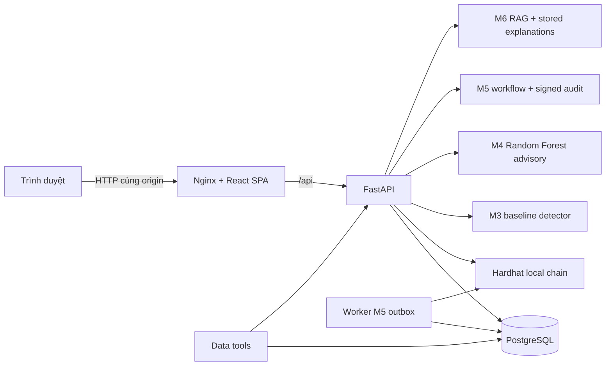

# Hướng dẫn cài đặt ColdChain

Tài liệu này hướng dẫn chạy ColdChain mô phỏng trên máy cá nhân. Chính sách nhiệt độ là chính sách giảng dạy, không thay thế quy định bảo quản hay tư vấn chuyên môn. Windows và Linux chưa được kiểm thử triển khai thực tế; macOS đã được kiểm thử trong Compose project cô lập, xem [deployment-handover.md](deployment-handover.md).

## 1. Kiến trúc



React/Nginx phục vụ giao diện và chuyển tiếp `/api` tới FastAPI. FastAPI và worker dùng PostgreSQL; service migration áp dụng schema khi khởi động. M3 phát hiện excursion theo baseline cố định. M4 cung cấp dự đoán advisory. M5 quản lý disposition, release, blockchain outbox và signed audit; Hardhat là chain cục bộ. M6 truy xuất SOP và lưu giải thích. Cấu hình mẫu tắt LLM provider. Data simulator tạo dữ liệu; `data-tools` xác minh, nhập và replay fixture.

## 2. Yêu cầu

| Thành phần | Mục đích | Kiểm tra |
|---|---|---|
| Git | Tải mã nguồn | `git --version` |
| Docker Desktop + Compose v2 | Chạy frontend, backend, PostgreSQL, chain | `docker --version`; `docker compose version` |
| PowerShell (Windows) hoặc Terminal (macOS) | Nhập lệnh | Có sẵn trên hệ điều hành |
| Python 3 | Helper môi trường macOS/Linux | `python3 --version` |
| Internet | Clone và tải image/package khi build | Kết nối ổn định |

Docker Desktop phải đang chạy trước khi dùng Compose. Tài liệu không có căn cứ để cam kết cấu hình phần cứng tối thiểu; nên dành ít nhất 4 GB RAM khả dụng cho Docker cùng dung lượng trống cho image và fixture. Dashboard mặc định bind `127.0.0.1:3000`, Hardhat RPC `127.0.0.1:8545`; backend `8000` và PostgreSQL `5432` chỉ ở trong Compose network. Cổng bận thì đổi `FRONTEND_PORT` hoặc `CHAIN_PORT` trong `.env`.

## 3. Windows 10/11 (PowerShell)

1. Cài Git và Docker Desktop, bật WSL 2 nếu Docker yêu cầu. Mở Docker Desktop và chờ Running.
2. Mở PowerShell, kiểm tra `git --version`, `docker --version`, `docker compose version`.
3. Clone repository:

   ```powershell
   git clone https://github.com/ntruonghuynh/ColdChain.git
   cd ColdChain
   ```

4. Tạo cấu hình riêng và chạy helper:

   ```powershell
   Copy-Item .env.example .env
   powershell -NoProfile -ExecutionPolicy Bypass -File .\scripts\setup_local_env.ps1
   ```

   Helper tạo tên Compose/image riêng và secret local; không chia sẻ `.env`.
5. Với database demo mới, mở `.env` bằng `notepad .env`; đặt `LOCAL_DEMO_MODE=true`, giữ `APP_ENV=local` và `FRONTEND_BIND_ADDRESS=127.0.0.1`, lưu trước lần khởi động/seed đầu. Không bật mode trên DB đã có user hay máy phục vụ mạng.
6. Kiểm tra và khởi động:

   ```powershell
   docker compose config --quiet
   .\start.bat
   docker compose ps
   ```

   Chờ service healthy; lần đầu build có thể lâu. `start.bat` không tự nhập dữ liệu.
7. Kiểm tra API qua cùng origin:

   ```powershell
   Invoke-RestMethod http://127.0.0.1:3000/api/health
   ```

   Thay cổng nếu `FRONTEND_PORT` khác. Kỳ vọng health thành công và migration head `0006_m6_llm_explanations`.
8. Làm theo mục 7 để nhập dữ liệu, rồi mở `http://127.0.0.1:3000` và đăng nhập bằng role phù hợp.

Windows chưa được chạy kiểm thử trên Windows thật; đây là lệnh PowerShell đã rà soát tĩnh. Nếu helper bị chặn, dùng đúng lệnh `powershell ... -ExecutionPolicy Bypass` ở trên, không đổi execution policy toàn hệ thống.

## 4. macOS

1. Cài Git và Docker Desktop, mở Docker Desktop. Trong Terminal chạy `git --version`, `docker --version`, `docker compose version`, `python3 --version`.
2. Clone và thiết lập:

   ```bash
   git clone https://github.com/ntruonghuynh/ColdChain.git
   cd ColdChain
   cp .env.example .env
   python3 scripts/setup_local_env.py
   ```

3. Sửa `.env` trước lần khởi động đầu: `LOCAL_DEMO_MODE=true`, `APP_ENV=local`, `FRONTEND_BIND_ADDRESS=127.0.0.1`.
4. Khởi động bằng `./start.command`. Nếu thiếu quyền thực thi: `chmod +x start.command`. Có thể chạy thủ công:

   ```bash
   docker compose config --quiet
   docker compose up -d --build --wait --wait-timeout 600
   docker compose ps
   ```

5. Kiểm tra `http://127.0.0.1:3000/api/health`, nhập fixture theo mục 7, rồi mở `http://127.0.0.1:3000`.

macOS đã được kiểm thử với archive mã nguồn sạch và Compose project cô lập. Linux chưa được kiểm thử.

## 5. Cấu hình môi trường

`.env.example` là mẫu không có secret; `.env` chứa cấu hình riêng và bị Git bỏ qua. Compose đọc `.env` để cấu hình services; ứng dụng chỉ nhận các biến được truyền vào container. Sau khi chỉnh, kiểm tra `docker compose config --quiet`. Không đổi tên biến theo suy đoán.

| Biến | Mục đích / yêu cầu | Ví dụ an toàn và lưu ý |
|---|---|---|
| `COMPOSE_PROJECT_NAME` | Bắt buộc, cô lập network/volume | Helper sinh tên riêng; không trùng project khác |
| `APP_ENV`, `TZ` | Môi trường và timezone | `local`, `UTC`; demo alias cần `local` |
| `BACKEND_IMAGE`, `BACKEND_TEST_IMAGE`, `CHAIN_IMAGE`, `FRONTEND_IMAGE` | Image tag scoped theo project | Để helper sinh, không ghi đè tag dùng chung |
| `POSTGRES_DB`, `POSTGRES_USER`, `POSTGRES_PASSWORD` | Kết nối database | Password do helper sinh; đổi password sau khi volume đã tạo không đổi password trong DB cũ |
| `FRONTEND_PORT`, `FRONTEND_BIND_ADDRESS` | Cổng và địa chỉ dashboard | `3000`, `127.0.0.1`; alias demo yêu cầu loopback |
| `LOCAL_DEMO_MODE` | Cho phép username/password lớp học | Mặc định `false`; chỉ `true` trên DB mới, `APP_ENV=local`, loopback |
| `JWT_SECRET`, `JWT_EXPIRES_MIN` | Ký token, thời hạn | Secret do helper tạo; không chia sẻ token |
| `*_DEMO_PASSWORD`, `AUDIT_SIGNING_KEY` | Tài khoản thường và audit signing | Secret local do helper tạo; không gửi `.env` |
| `SIM_CANONICAL_SEED`, `SIM_EVALUATION_SEEDS`, `SIM_JOURNEYS_PER_SEED` | Metadata dataset | Fixture dùng seed 11; không dùng seed đánh giá |
| `ML_MODEL_VERSION` | Có trong `.env.example` | Compose hiện không truyền biến này; adapter dùng model cố định `coldchain-rf-v1.0.0` |
| `CHAIN_RPC_URL`, `CHAIN_ID`, `CHAIN_PORT`, `CHAIN_BIND_ADDRESS`, `CHAIN_MNEMONIC` | RPC local và bind | URL nội bộ `http://chain:8545`, chain `31337`, host loopback |
| `CHAIN_ACCOUNT_INDEX_*`, `CHAIN_CONFIRMATIONS` | Tài khoản Hardhat demo và confirmations | Giữ giá trị mẫu; không đặt private key thật |
| `OUTBOX_MAX_ATTEMPTS`, `OUTBOX_BASE_DELAY_MS` | Retry worker | Mặc định `8`, `500`; pending không tự chứng minh chain lỗi |
| `M6_RUNTIME_VERSION`, `LLM_PROVIDER`, `LLM_MODEL`, `LLM_API_BASE_URL`, `LLM_API_KEY`, `LLM_CORPUS_DIR` | M6, provider tùy chọn và đường dẫn corpus trong container | `LLM_PROVIDER=disabled`; không cần API key cho demo |
| `LLM_TIMEOUT_S`, `LLM_MAX_RETRIES`, `LLM_MAX_OUTPUT_TOKENS`, `LLM_FALLBACK_ENABLED` | Tham số provider | Giữ mặc định; không cần bật provider để xem trang |
| `LLM_PRICE_INPUT_PER_MTOK_USD`, `LLM_PRICE_OUTPUT_PER_MTOK_USD` | Metadata giá | Để trống nếu không có bảng giá |

M6 offline/provider-disabled mode cho phép đọc readiness và explanation đã lưu mà không gọi nhà cung cấp.

## 6. Local demo authentication

Trên database mới, bật `LOCAL_DEMO_MODE=true` trước lần startup/seed đầu tiên; giữ `APP_ENV=local` và `FRONTEND_BIND_ADDRESS=127.0.0.1`. Backend từ chối cấu hình môi trường khác hoặc bind không-loopback. Lần seed đầu trên DB trống sẽ tạo tài khoản, hash bằng PBKDF2 và cấp role bình thường:

| Username | Password | Role |
|---|---|---|
| `quality` | `123` | `QUALITY` |
| `warehouse` | `123` | `WAREHOUSE` |
| `carrier` | `123` | `CARRIER` |
| `shipper` | `123` | `SHIPPER` |
| `admin` | `123` | `ADMIN` |

Provisioning idempotent, không thay password/user đã tồn tại. Nếu user đã seed trước khi bật mode, backend từ chối tạo alias trên DB có sẵn user; dùng credential `*.demo` đã sinh hoặc một project/database demo mới. Không xóa volume để né lỗi. Khi tắt mode, aliases ngắn không đăng nhập được. Đây chỉ là shared credential cho lớp học trên localhost, không dùng trên server công khai hay mạng dùng chung. Kiểm tra an toàn bằng cách chỉ đọc ba dòng `LOCAL_DEMO_MODE`, `APP_ENV`, `FRONTEND_BIND_ADDRESS` trong `.env`; không chia sẻ cả file.

## 7. Nhập 200 chuyến đi

Chạy từ thư mục gốc sau khi services healthy. Các lệnh là CLI thật của `data-tools`, ghi vào database thuộc project hiện tại.

```bash
docker compose --profile tools run --rm data-tools python -m app.dataset verify data/release/coldchain-sim-v1.0.0-seed11
docker compose --profile tools run --rm data-tools python -m app.dataset import data/release/coldchain-sim-v1.0.0-seed11
docker compose --profile tools run --rm data-tools python -m app.dataset status
docker compose --profile tools run --rm data-tools python -m app.monitoring replay
docker compose --profile tools run --rm data-tools python -m app.monitoring summary
```

`verify` kiểm tra fixture tracked; `import` nạp 200 simulated journeys và idempotent theo fingerprint; `status` báo trạng thái import; `replay` chạy M3 detector (import riêng không tự phát hiện); `summary` tổng hợp kết quả. Fixture seed 11 đã xác minh cho 105 `TEMPERATURE_EXCURSION` và 41 `DATA_GAP` (146 incidents), trước kịch bản ocean bổ sung. Kết quả có thể đổi nếu đã import/replay thêm dữ liệu.

Tùy chọn thêm kịch bản ocean gap trên DB demo:

```bash
docker compose --profile tools run --rm data-tools python -m app.monitoring demo-ocean --source SIM-S11-J0154
docker compose --profile tools run --rm data-tools python -m app.monitoring summary
```

Lệnh này tạo shipment mô phỏng `DEMO-OCEAN-...`, có thể chạy lại ổn định; đây là thao tác CLI ghi dữ liệu, không phải nút trên web. `event_at` là lúc cảm biến ghi nhận; `received_at` là lúc máy chủ nhận dữ liệu. Replay giữ riêng hai thời điểm để mô phỏng dữ liệu đến trễ. Gap dài có thể là `UNKNOWN`, tuyệt đối không hiểu là an toàn.

Mở dashboard để xem Shipments, Temperature Monitoring và Excursion Queue. Mọi fixture là simulated teaching data; không dùng seed đánh giá hoặc artifact riêng M6.

## 8. Dừng và khởi động lại an toàn

Dừng rồi chạy lại, giữ container và dữ liệu:

```bash
docker compose stop
docker compose start
```

Xóa container/network nhưng giữ named volumes:

```bash
docker compose down
docker compose up -d --build --wait --wait-timeout 600
```

PostgreSQL lưu trong volume có tên theo project. Hardhat chain state nằm trong RAM và mất khi container bị remove. Xem trạng thái `docker compose ps`, log giới hạn `docker compose logs --tail 100 backend frontend db migrate`. Không chạy `down --volumes` nếu chưa xác minh project hiện tại là disposable và chấp nhận xóa chính dữ liệu đó; không chạy Docker-wide prune.

Tiếp tục: [Hướng dẫn sử dụng](huong-dan-su-dung.md), [Kịch bản demo](kich-ban-demo.md), [Xử lý lỗi](xu-ly-loi.md).
