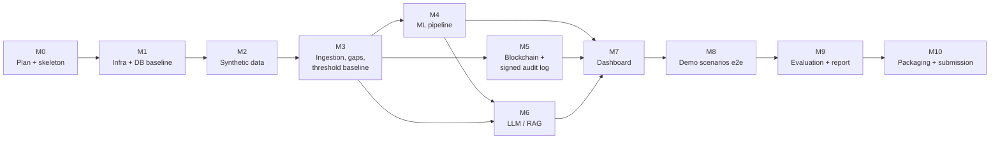

# Implementation Plan — Cold Chain Monitoring and Excursion Response

| Item | Value |
|---|---|
| Status | M0 accepted · M1 implemented (2026-11-14) · M2 implemented and merged · **M3 implemented 2026-11-15, awaiting the owner's acceptance** (report `docs/milestones/m3/README.md`; contract `docs/design/m3-baseline-detector-contract.md` approved with U-01 to U-08) |
| Inputs | `docs/requirements-analysis.md`, `docs/architecture.md` |
| Course window | 8 to 10 weeks (brief, page 1) |
| Last updated | 2026-11-15 |

## Working rules for every milestone

- One milestone at a time. A milestone starts only after the previous one is accepted by the project owner.
- A milestone is **done** when all its acceptance criteria pass, its tests run green locally (and in Docker where stated), documentation is updated, and a milestone report lists changed files, commands run, test results and open issues.
- Requirement IDs in "Closes" are the ones the milestone must fully satisfy; others may be partially advanced.
- No metric, test result or dataset statistic is written into documentation unless it was produced by a run that is saved in the repository.

## Overview

Suggested timing for a 10-week course (adjust to the team): week 1 M0–M1, week 2 M2, week 3 M3, week 4 M4, week 5 M5, week 6 M6, week 7 M7, week 8 M8, week 9 M9, week 10 M10. M4, M5 and M6 can run in parallel if the team splits work, but each is still accepted separately.

---

## M0 — Requirements, architecture, plan, repository skeleton

| Field | Content |
|---|---|
| Objectives | Turn the brief into numbered requirements; design the architecture; plan milestones; create the repository skeleton and Claude Code rules. |
| Files / modules | `docs/requirements-analysis.md`, `docs/architecture.md`, `docs/implementation-plan.md`, `docs/requirements/` (brief), `README.md`, `CLAUDE.md`, `.gitignore`, `.gitattributes`, `.editorconfig`, `.env.example`, module `README.md` files in `frontend/ backend/ ml/ llm/ blockchain/ data/ scripts/` |
| Dependencies | Assignment PDF |
| Acceptance criteria | Every mandatory brief statement has a requirement ID and verification method; architecture covers all seven modules with a diagram; every milestone has objectives, files, dependencies, acceptance criteria, tests and deliverables; no implementation code; no secrets in the tree. |
| Tests | None (documentation only). Manual consistency check of IDs between the three documents. |
| Deliverables | The files above; open decisions list (requirements analysis §15). |
| Closes | Planning only |

## M1 — Infrastructure and conventional database baseline

| Field | Content |
|---|---|
| Objectives | Running Docker Compose stack with PostgreSQL, a FastAPI backend with health check and migrations, and an empty frontend shell. Core schema for organizations, users, products, policies, shipments, sensors, readings, context, ingest batches, business events. Seed the teaching policy (after D-01 approval) and demo users. |
| Files / modules | `docker-compose.yml`; `backend/pyproject.toml`, `backend/requirements*.txt`, `backend/Dockerfile`, `backend/alembic.ini`, `backend/migrations/` (revision `0001`), `backend/app/{main.py, core/, db/, api/, seed/}`, `backend/tests/`; `frontend/package.json`, `frontend/package-lock.json`, `frontend/vite.config.ts`, `frontend/tsconfig.json`, `frontend/src/`, `frontend/Dockerfile`, `frontend/nginx.conf`; root `start.command`, `stop.command`, `start.bat`, `stop.bat`; `scripts/smoke_test.py` |
| Owner changes at M1 start (2026-11-14) | App served at `http://localhost:3000` (not 8080); start/stop scripts are root-level `.command`/`.bat` files (not `scripts/start.sh`/`.ps1`); no `reset` script (deleting data is a deliberate manual step, `docker compose down -v`); teaching policy values approved (requirements analysis §13). |
| Dependencies | M0 accepted; decision D-01 (policy values) for the seed |
| Acceptance criteria | `docker compose up --build` starts `db`, `backend`, `frontend` healthy from a clean clone with only `.env` copied from `.env.example`; `GET /api/health` reports DB connectivity; migrations create the schema; timestamps are `timestamptz`; `(sensor_id, event_at)` is unique on readings; frontend shows a page that calls the health endpoint and displays the real result; the app is reachable at `http://localhost:3000` and reaches the backend through the `/api` reverse proxy; data persists across `down`/`up`; pages for later milestones say "Not implemented yet". |
| Tests | pytest: migration up/down on a test database; models match migrations; model constraints (unique reading key, non-null `event_at`/`received_at`, UTC storage, QUALITY-only dispositions, RELEASE-only warehouse release); seed values, idempotency and immutability; health endpoint (ok and 503); error envelope. Frontend: Vitest component tests, type-check, production build. Stack: `scripts/smoke_test.py` (startup, proxy, backend outage, shutdown, persistence). |
| Deliverables | Running skeleton stack; schema diagram updated if it changed; M1 report. |
| Closes | SC-01, FR-02 (IDs in schema), FR-05 (schema part), FR-06 (storage), DATA-01 to DATA-03 (schema), NFR-05, NFR-06 |

## M2 — Synthetic dataset, data dictionary and provenance

| Field | Content |
|---|---|
| Objectives | Seeded simulator producing ≥200 journeys per seed with normal variation, gradual warming excursions, door-open events, sensor spikes, sensor bias, battery decline and communication outages (including ocean coverage gaps with buffered upload). Ground truth stored separately from observations. |
| Files / modules | `data/generator/` (Python package + CLI), `data/generator/config/*.yaml` (scenario mix, ambient profiles), `data/dictionary/data-dictionary.md`, `data/dictionary/provenance.md`, `data/generated/` (git-ignored working output), `data/release/` (canonical dataset if D-05 approved), `data/generator/tests/` |
| Dependencies | M1 (schema field names); D-01, D-02, D-05 |
| Acceptance criteria | Same seed + config → byte-identical output (checked by SHA-256 in `manifest.json`); each seed has ≥200 journeys; every scenario type is present with counts recorded in the manifest; every journey has an ambient profile label; outages produce readings whose `received_at` is later than `event_at` by the outage length; ground truth includes labelled excursion intervals; data dictionary documents units, timezone (UTC), missing-value meaning, label source and provenance for every field. |
| Tests | Determinism test (two runs, same hash); schema test (required fields, types, UTC); scenario coverage test; outage timestamp test; label/observation separation test; at least five seeds generate successfully. |
| Deliverables | Generator, data dictionary, provenance record, canonical development dataset (seed 11) and manifests for the reserved evaluation seeds 22, 33, 44, 55, 66 (A-13, approved 2026-11-15). |
| Closes | SC-02, DATA-04, DATA-06 (dataset side), DATA-07, DATA-08, DATA-09, EVAL-10 (data side), SUB-02 (draft) |
| As implemented (2026-11-14) | Owner's M2 instructions added: database import (migration `0002`: `dataset_release`, `shipment.source_dataset_id`, schema `ground_truth`; `backend/app/dataset/`), deterministic 70/15/15 journey split (`splits/journey_split.csv`), sampling interval 5 min and durations 24–72 h as approved simulation assumptions. Configuration file is `data/generator/config/coldchain-sim-v1.yaml`. Generator tests live in `data/generator/tests/` and run inside the `backend-tests` container. New Compose service `data-tools` (profile `tools`). Raw run output: `docs/milestones/m2/raw/`. |

## M3 — Ingestion, validation, gap detection, threshold baseline, excursion queue

| Field | Content |
|---|---|
| Objectives | Batch ingestion API with validation and idempotency; gap detector; policy threshold engine; incident creation; re-evaluation on late data; excursion queue API; loader that replays generated journeys through the ingestion API. |
| Files / modules | As built: `backend/app/domain/{rules, validation, detector, reconcile, replay}.py`, `backend/app/services/{ingest, detection, queries, demo}.py`, `backend/app/api/{ingest, monitoring, monitoring_schemas}.py`, `backend/app/monitoring/` (replay and demo commands; replaces the planned `scripts/replay_dataset.py`), `backend/app/evaluation/` (isolated development evaluation), migration `0003`, frontend pages Temperature Monitoring, Excursion Queue and Incident detail, tests `backend/tests/test_m3_*.py` and `frontend/src/pages/monitoring.test.tsx` |
| Dependencies | M1, M2; D-01, D-09 (BR-02 to BR-09) |
| Acceptance criteria | Invalid records rejected with reasons (BR-08); duplicates handled per BR-07; both timestamps stored unchanged; stale telemetry is shown as monitoring state STALE/UNKNOWN (never safe, no incident); confirmed gaps >15 min are UNKNOWN, confirmed gaps ≥30 min open `DATA_GAP` incidents (C-02); BR-02 excursions open `TEMPERATURE_EXCURSION` incidents; a buffered batch arriving after a gap triggers re-evaluation and the excursion is detected with original `event_at`; UNKNOWN time is never counted as in range; excursion queue lists open incidents by category. |
| Tests | Boundary cases B01–B80 of the detector contract §7 (one test per case, rule ID in the name or docstring; coverage in `docs/milestones/m3/README.md` §6), including exactly 8.0 °C, exactly 30 min, exactly 15 min gap, 7 min 30 s continuity, replay causality; property test that no gap interval is ever reported in-range; integration test: out-of-order batch after outage; idempotent re-upload of the same batch; conflicting duplicate rejected. |
| Deliverables | Working ingestion and baseline detection; API docs (OpenAPI); M3 report. |
| Decisions in force (2026-11-15) | Contract `docs/design/m3-baseline-detector-contract.md` is the specification and is implemented. Approved: D-01 (5-min interval in detector configuration), BR-05, C-01 to C-10, the BR-06 to BR-09 interpretations, U-01 to U-08 (BR-09 amended explicitly by U-01; BR-10 to BR-15 reviewed with no M3 conflict). Policy file v1.0 and the canonical dataset are unchanged. Open (not blocking): contract §9 O-1 to O-3 |
| Closes | FR-01, FR-03, FR-04, FR-05, FR-10, FR-11, FR-12 (baseline side), FR-20 (API), EVAL-01, EVAL-13 (functional side) |

## M4 — ML pipeline

**Status: implemented; final verification and report in `docs/milestones/m4/README.md`.** This milestone is complete pending project-owner review. Do not start M5 from this branch.

| Field | Content |
|---|---|
| Objectives | Windowing and features, journey-level splits, baseline and candidate models, validation-only tuning, freezing, single test run per seed, validated prediction API in the backend. |
| Files / modules | `ml/coldchain_ml/{windows.py, features.py, labels.py, splits.py, train.py, tune.py, freeze.py, evaluate.py, registry.py, predict.py}`, `ml/configs/*.yaml`, `ml/registry/<model_version>/` (model card, feature spec, hashes), `ml/tests/`, `backend/app/integrations/ml_adapter.py`, `backend/app/api/predictions.py` |
| Dependencies | M2 (data), M3 (baseline engine for comparison and shared policy code) |
| Acceptance criteria | No journey appears in more than one partition (asserted in code); test set contains all ambient profiles; features use only data up to window end; thresholds tuned only on validation; frozen artifact includes feature spec, preprocessing config, data manifest hash and file hashes; prediction API rejects frames that do not match the spec; every stored prediction carries the model version; ML results cannot change shipment state. |
| Tests | Leakage tests (group split, no future data in features, labels not in feature columns); deterministic training with fixed seed; feature unit tests on hand-built series (spike vs gradual warming); API schema tests; test that the predict path has no write access to dispositions or releases. |
| Deliverables | Frozen model version(s), model card with validation results only, per-seed test results saved as raw files (reported in M9). |
| Decisions in force (2026-11-15) | **D-12:** a single label-builder module reads ground-truth events as supervised targets and is added explicitly to the allow-list in `backend/tests/test_ground_truth_boundary.py`. Feature extraction, inference and the predict API use observed data only. **D-13:** train on seed-11 `train`, tune on seed-11 `validation`; the seed-11 `test` partition is a single regression check after freezing, never used for iterative tuning. Seeds 22–66 are not opened in M4. The freeze record stores the model version, seed assignments and protocol version. **D-05:** frozen artifacts are committed with SHA-256 checksums. |
| Closes | FR-13, FR-14, FR-15 (API side), DATA-05, ML-01 to ML-10, NFR-04 (model part), SUB-03 (model part) |

## M5 — Blockchain module, chain gateway, outbox, signed audit log

| Field | Content |
|---|---|
| Objectives | `ColdChainRegistry` contract with roles and state machine; deployment and role setup; backend outbox and worker relay with retry and duplicate protection; read-side reconciliation and verification endpoints; signed hash-chained DB audit log for the comparison. |
| Files / modules | `blockchain/contracts/ColdChainRegistry.sol`, `blockchain/hardhat.config.ts`, `blockchain/scripts/deploy.ts`, `blockchain/test/*.ts`, `blockchain/Dockerfile`, `blockchain/ROLES.md`; `backend/app/integrations/chain_gateway.py`, `backend/app/worker/outbox_relay.py`, `backend/app/services/{dispositions.py, release.py, reconcile.py, verify.py}`, `backend/app/integrations/audit_log.py`; Compose services `chain`, `chain-deploy`, `worker` |
| Dependencies | M3 (incidents, business events); D-08, D-09 |
| Acceptance criteria | Only QUALITY can record a disposition (contract and API); release reverts without a confirmed RELEASE disposition; invalid transitions revert; duplicate business reference reverts on chain and is idempotent in the API; worker survives a paused chain and confirms after unpause with no duplicate effect; reconciliation lists every business reference with DB/outbox/chain status; altered file or record is reported as a hash mismatch; signed audit log detects edited or deleted entries. |
| Tests | Hardhat tests for every function × allowed and forbidden role, each invalid transition, duplicate refs; backend tests for outbox idempotency, retry with `isReferenceUsed` check, reconciliation after outage (using `docker compose pause`), tamper detection, audit-log chain verification. |
| Deliverables | Contract code, `ROLES.md` (role rules), deployment output format, M5 report. |
| Closes | SC-03, FR-23, FR-24, FR-26 (data), FR-35 (API), FR-36 (API), BC-01 to BC-14, NFR-07, SUB-04 |

## M6 — LLM / RAG module

| Field | Content |
|---|---|
| Objectives | Approved teaching corpus; retriever; versioned prompts; Anthropic provider adapter and `disabled` mode; read-only tools with validated arguments; structured output with citation and version checks; insufficient-evidence path; draft storage with usage, latency and cost; evidence package builder; the 40-case evaluation set. |
| Files / modules | `llm/corpus/approved/*.md`, `llm/corpus/untrusted_samples/`, `llm/coldchain_llm/{retrieval.py, providers/base.py, providers/anthropic_provider.py, providers/disabled.py, prompts.py, tools.py, schemas.py, validate.py, draft.py}`, `llm/prompts/response_draft/v1.md`, `llm/eval/cases/*.jsonl` (≥40), `llm/tests/`, `backend/app/integrations/llm_adapter.py`, `backend/app/services/evidence_package.py` |
| Dependencies | M3 (incidents, readings), M4 (detections); D-03, D-04 |
| Acceptance criteria | Retrieval returns only approved documents for the shipment's procedure version; every draft cites policy version and sensor interval; every citation refers to a supplied source ID; missing or conflicting evidence yields `insufficient_evidence`; invalid tool arguments are rejected before execution; no tool or output path can change shipment state; without an API key the API returns `not_configured` and the UI shows no draft text; every draft stores prompt version, provider, model, tokens, latency and cost. Eval set has 10 cases each of normal, missing evidence, conflicting evidence, hostile document instructions. |
| Tests | Unit tests with a recorded-response test double for the provider (clearly test-only), covering schema validation, citation checking, insufficient-evidence and tool-argument rejection; retrieval tests on a fixed corpus; `disabled` mode test. Live-provider tests are opt-in (marker) and need a key. |
| Deliverables | Corpus with versions, prompt v1, eval case set, M6 report. |
| Closes | FR-21, FR-22 (builder), FR-25 (LLM side), LLM-01 to LLM-12, NFR-11, SUB-03 (prompt part) |

## M7 — Frontend dashboard

| Field | Content |
|---|---|
| Objectives | All required views connected to real API data, with role-aware navigation and clear labelling of simulated data and the technical boundary. |
| Files / modules | `frontend/src/{api/ (generated client), auth/, pages/Shipments, pages/ShipmentDetail, pages/ExcursionQueue, pages/IncidentDetail, pages/DecisionHistory, pages/Reconciliation, pages/Verify, components/TemperatureTimeline, components/GapIndicator, components/DraftView, components/SimulatedBanner}`, frontend tests |
| Dependencies | M3, M4, M5, M6 APIs |
| Acceptance criteria | Timeline shows policy band, readings by `event_at`, UNKNOWN gaps as a distinct shaded region, delayed arrivals marked; queue shows category and age; draft view shows citations, policy version and interval, or the explicit not-configured/insufficient status; disposition form only for QUALITY, and server rejection is displayed if bypassed; decision history and reconciliation show chain references; no hard-coded example values; simulated-data banner and boundary notice always visible. |
| Tests | Component tests (Vitest + Testing Library) for timeline gap rendering, draft states, role-based controls; type-check; one browser smoke test (Playwright) against the Compose stack. |
| Deliverables | Usable dashboard, screenshots in the M7 report. |
| Closes | FR-15 (UI), FR-20 (UI), FR-30 to FR-36, NFR-01, NFR-02 (UI) |

## M8 — End-to-end demonstration scenarios

| Field | Content |
|---|---|
| Objectives | Scripted, repeatable runs of the four required scenarios against the full Compose stack, each with a log that proves the outcome. |
| Files / modules | `scripts/demo/{01_normal_transaction, 02_ocean_gap, 03_unauthorized_action, 04_retry_recovery}.py`, `scripts/demo/README.md`, e2e tests under `backend/tests/e2e/` |
| Dependencies | M3 to M7 |
| Acceptance criteria | DEMO-02: shipment goes from creation to release with every business event confirmed on chain. DEMO-01: ocean gap → UNKNOWN interval → buffered upload with original timestamps → excursion flagged → release blocked → QUALITY disposition → release allowed only for RELEASE. DEMO-03: non-QUALITY disposition attempt rejected by API **and** by contract when sent directly. DEMO-04: chain paused during submission → retry after unpause → exactly one on-chain record and one DB effect. Each script exits non-zero on any failed check. |
| Tests | The four scripts run as e2e tests; reconciliation shows zero mismatches at the end of each. |
| Deliverables | Demo scripts and logs, demo run instructions. |
| Closes | SC-04, FR-24 (e2e), DEMO-01 to DEMO-04 |

## M9 — Evaluation and test report

| Field | Content |
|---|---|
| Objectives | Run the configured experiments and write the test report with raw results. |
| Files / modules | `scripts/eval/{detection.py, reliability.py, operations.py, llm_quality.py, chain_system.py, run_all.py}`, `scripts/eval/configs/*.yaml`, `docs/evaluation/runs/<run_id>/` (raw CSV/JSONL, configs, commit hash), `docs/evaluation/test-report.md` |
| Dependencies | M4 (frozen model), M5, M6, M8; D-04 (LLM budget), D-07 |
| Acceptance criteria | Detection (event-level precision, recall, delay — both definitions) and reliability (false alarms per journey, missing-reading performance) for E0 vs E1 on ≥5 seeds; operations timing for E0–E3; LLM quality on ≥40 cases with all six measures; blockchain tests (altered files, unauthorized writes, invalid transitions, duplicates, outage with retry) with accept/reject counts, p50/p95 confirmation latency, consistency after recovery; E3 vs E3-alt comparison; every primary metric reported with sample size, baseline, candidate, absolute difference and uncertainty where supportable; every number in the report traceable to a saved raw file; limitations section. |
| Tests | Unit tests for metric functions on hand-computed examples (event matching, delay, p50/p95, bootstrap); a check that the report's numbers match the raw files. |
| Deliverables | Test report, raw results, evaluation configs. |
| Decisions in force (2026-11-15) | **D-13:** final results come from seeds 22, 33, 44, 55, 66, evaluated with the frozen model and preprocessing only. Each run records the model version, seed assignments and protocol, and no setting is changed after looking at them. A change after that point requires a new model version and a fresh, recorded run. |
| Closes | ML-03, EVAL-02 to EVAL-12, EVAL-13 (measured), SUB-05, SUB-08 |

## M10 — Packaging, distribution and submission

| Field | Content |
|---|---|
| Objectives | ZIP package that a non-technical student can run with Docker Desktop; student guide; demo video script; final submission checklist; configurable, idempotent first-run import of the canonical dataset (D-10, approved 2026-11-15; reuses the M2 importer). |
| Files / modules | `scripts/package_zip.sh`, root `start.*`/`stop.*` (from M1), `docs/student-guide.md` (with screenshots), `docs/demo-script.md`, `docs/submission-checklist.md`, final `README.md` |
| Dependencies | M1 to M9 |
| Acceptance criteria | On a clean machine with only Docker Desktop: unzip, copy `.env.example` to `.env` (or let the start script do it), run one start command, open the dashboard, run all four demo scenarios. ZIP contains no `.env`, keys, `node_modules`, caches or generated scratch data. Demo script fits 6–8 minutes and covers DEMO-01 to DEMO-04. Checklist maps every SUB-xx to a file. |
| Tests | Fresh-clone and fresh-unzip run on macOS and Windows (manually recorded); script that lists ZIP contents and fails on forbidden files. |
| Deliverables | Release ZIP, student guide, demo script, recorded demonstration (6–8 min), submission checklist. |
| Closes | NFR-09, SUB-01, SUB-06, SUB-07, DEMO-05, NFR-02 (docs) |

---

## Cross-milestone requirements

| Requirement | How it is kept true across milestones |
|---|---|
| NFR-03 Reproducibility | Every generator, training and evaluation entry point takes a seed and config file and writes them next to its output. |
| NFR-08 No secrets | `.gitignore` covers `.env*` (except `.env.example`); every milestone report includes a staged-file check. |
| NFR-10 Stack | Changes to the stack need an explicit decision recorded in `docs/architecture.md`. |
| NFR-12 Tests for rules | Each BR-xx has at least one test that names the rule ID in the test name or docstring. |

## Risk register

| ID | Risk | Effect | Mitigation |
|---|---|---|---|
| R-01 | Policy values (BR-01 to BR-05) not approved or changed late | Data, labels and tests must be redone | Approve D-01 before M2; keep values in one policy config |
| R-02 | Synthetic labels make the task too easy or too hard | Results not meaningful | Scenario mix and noise in config; report limitations honestly |
| R-03 | Hardhat node loses state on restart | DB and chain disagree | Reset together; pause for outage tests; reconciliation shows mismatch |
| R-04 | No LLM API key or budget | LLM evaluation cannot run | Decide D-04 early; system works without LLM; report "not run" rather than guessing |
| R-05 | Docker Desktop problems on student machines (RAM, Apple Silicon/Windows) | Demo fails | Multi-arch base images; test on both OS in M10; documented minimum RAM |
| R-06 | Scope creep across ML/LLM/blockchain | Late delivery | One milestone at a time; optional extension (OPT-01) only after M10 |
| R-07 | LLM non-determinism | Eval numbers vary | Store raw outputs; report variation |
| R-08 | Leakage between partitions | Inflated ML results | Group split asserted in tests; test set used once after freeze |
